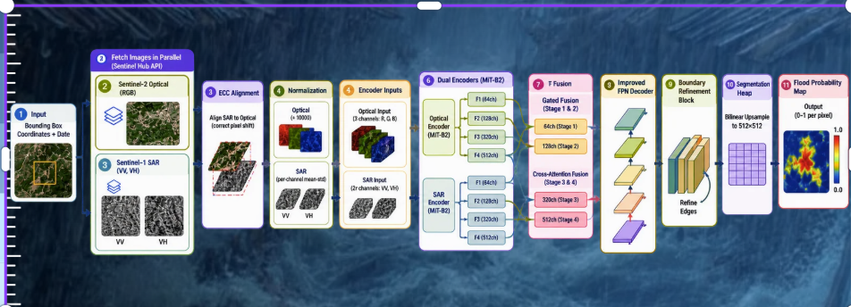

<div align="center">

# 🛡️ AEGIS: Autonomous Multi-Source Disaster Intelligence & Flood Response Platform

### Fusing Dual-Encoder Satellite Earth Observation, MirEye Physical DEM Hydrology, 4D Spatiotemporal Depth Nowcasting & TinyFish Autonomous Web Intelligence Agents

[](https://fastapi.tiangolo.com)
[](https://expo.dev)
[](https://reactnative.dev)
[](https://expo.dev/artifacts/eas/isfpoGm44k0wFhYXlVvSj3JBe9-WcBdcEVIFyCfP1Wk.apk)
[](https://python.org)
[](https://tinyfish.ai)
[](https://ai.google.dev/)
[](https://huggingface.co/)
[](LICENSE)

<br/>

**Aegis is an end-to-end autonomous disaster response platform fusing dual-encoder satellite Earth observation (SAR C-Band + Optical), sub-meter physical elevation intelligence (MirEye API / USGS 3DEP DEM), continuous Topographic Wetness Index (TWI) hydrology, TinyFish autonomous web intelligence agents, and 4D ConvGRU flood depth nowcasting into an actionable disaster operations hub with role-based civilian/commander interfaces and a standalone mobile Android application.**

</div>

---

## 📑 Table of Contents

1. [Executive Overview & The Multi-Scale Blind Spot](#-executive-overview--the-multi-scale-blind-spot)
2. [End-to-End System Architecture](#-end-to-end-system-architecture)
3. [TinyFish Autonomous Web Intelligence Engine (Core Implementation)](#-tinyfish-autonomous-web-intelligence-engine)
   - [The Ground Truth Blind Spot: Why Satellites + DEM Require Web Intelligence](#the-ground-truth-blind-spot)
   - [TinyFish Autonomous Agent Suite & APIs](#tinyfish-autonomous-agent-suite--apis)
   - [Multi-Source Government & Infrastructure Ingestion Matrix](#multi-source-government--infrastructure-ingestion-matrix)
   - [Deep Dive: Implementation in Backend (`app/intel/`)](#deep-dive-implementation-in-backend-appintel)
   - [Typed Evidence Ledger, Verification Grading (A-F), & Cross-Corroboration](#typed-evidence-ledger-verification-grading-a-f--cross-corroboration)
   - [Strict Anti-Prompt-Injection & SSRF-Protected Security Guarantees](#strict-anti-prompt-injection--ssrf-protected-security-guarantees)
4. [Deep Learning Architecture & Physical Hydrology Engine](#-deep-learning-architecture--pipeline)
   - [SegFormer MiT-B2 Dual-Encoder Satellite Fusion (SAR + Optical)](#segformer-mit-b2-dual-encoder-satellite-fusion)
   - [MirEye Physical Intelligence & TWI Hydrology](#mireye-physical-intelligence--twi-hydrology)
   - [4D Spatiotemporal ConvGRU Depth Nowcasting](#4d-spatiotemporal-convgru-depth-nowcasting)
   - [Elevation-Penalized Dijkstra Evacuation Routing](#elevation-penalized-dijkstra-evacuation-routing)
   - [Empirical Validation: Naive vs. Context-Aware Routing](#empirical-validation-naive-vs-context-aware-routing)
5. [Autonomous 6-Agent LangGraph Pipeline & Human-in-the-Loop (HITL) Gate](#-autonomous-6-agent-langgraph-pipeline--hitl)
6. [Cross-Platform Mobile & Web Tactical Interface](#-cross-platform-mobile--web-tactical-interface)
   - [Role-Based Access Control (Citizen vs. Official Commander)](#role-based-access-control-citizen-vs-official-commander)
   - [Live Web Intelligence Tactical HUD (TinyFish)](#live-web-intelligence-tactical-hud-tinyfish)
   - [Automated Emergency Voice Call Alert System](#automated-emergency-voice-call-alert-system)
   - [Standalone Android APK Direct Download](#standalone-android-apk-release)
   - [Tactical Disaster Map Visualizations](#-tactical-disaster-map-visualizations)
7. [Complete REST API Reference](#-complete-rest-api-reference)
8. [Repository Structure](#-repository-structure)
9. [Installation & Quickstart Guide](#-installation--quickstart-guide)
   - [Standalone Android APK Direct Download & Installation](#step-6-standalone-android-apk-direct-download--installation-)
10. [Environment Configuration Reference (`.env`)](#-environment-configuration-reference-env)
11. [Security, Privacy & Resilience](#-security-privacy--resilience)
12. [License & Acknowledgments](#-license--acknowledgments)

---

## 📋 Executive Overview & The Multi-Scale Blind Spot

During catastrophic flash flood events, incident commanders, emergency dispatchers, and trapped civilians suffer from **three critical operational blind spots**:

```
                                  CRITICAL DISASTER BLIND SPOTS
 ┌───────────────────────────────┐ ┌───────────────────────────────┐ ┌───────────────────────────────┐
 │ 1. THE "FLAT SATELLITE" BLIND │ │ 2. THE "NAIVE ROUTING" BLIND  │ │ 3. THE "GROUND REALITY" BLIND │
 │ Standard satellite masks only │ │ Navigation apps calculate     │ │ Satellites and DEM models     │
 │ capture surface water at over-│ │ shortest straight-line paths, │ │ cannot know about sudden dam  │
 │ pass time. They cannot see    │ │ steering evacuees straight    │ │ releases, flash cloudbursts,  │
 │ soil saturation or sub-surface│ │ through low-elevation terrain │ │ bridge washouts, or official  │
 │ pooling over next 60 minutes. │ │ basins and flooded dips.      │ │ transit/railway closures.     │
 └───────────────────────────────┘ └───────────────────────────────┘ └───────────────────────────────┘
```

### How Aegis Solves This

Aegis solves this by orchestrating a 4-tier multimodal intelligence stack:
1. **Satellite Earth Observation:** Sentinel-1 SAR (penetrating storm clouds at night) fused with Sentinel-2 multispectral imagery via a **dual-encoder SegFormer MiT-B2** model.
2. **Physical Terrain Hydrology:** Sub-meter **USGS 3DEP DEM elevation** and **Topographic Wetness Index (TWI)** via the **MirEye Earth API**, computing concave pooling sinks before rain crests.
3. **4D Spatiotemporal ConvGRU Depth Nowcasting:** Forecasting continuous street-level water depth ($0.0\,\text{m} - 2.5\,\text{m}$) across four horizons: Now (0m), +15m, +30m, and +60m.
4. **TinyFish Autonomous Web Intelligence Agents:** Live headless browser agents crawling official government flood portals (CWC river gauges, IMD weather warnings, NDMA SACHET feeds, NHAI highway notices, NTES railway status, and local news) to extract real-time ground truth that satellites cannot see.

---

## 🏛️ End-to-End System Architecture

```
                                     AEGIS DISASTER RESPONSE SYSTEM ARCHITECTURE
                                     
  ┌─────────────────────────────────────────────────────────────────────────────────────────────────────────────┐
  │                                        TACTICAL CLIENT APPLICATIONS                                         │
  │  React Native / Expo SDK 57 (Cross-Platform Mobile & Web)                                                   │
  │  • Citizen View: Real-time Inundation Map, Safe Shelter Corridors, Camera Ground Issue Reporting           │
  │  • Commander View: 4D Nowcast Player (0m/15m/30m/60m), TinyFish Web Intel HUD, HITL Dispatch, Voice Alerts  │
  └──────────────────────────────────────┬──────────────────────────────────────────────────────────────────────┘
                                         │ HTTP REST / SSE Stream
                                         ▼
  ┌─────────────────────────────────────────────────────────────────────────────────────────────────────────────┐
  │                                        FASTAPI REST & ORCHESTRATION GATEWAY                                 │
  │  • Endpoints: Satellite Detection, 4D Nowcasting, Ground Complaints, Twilio Voice, TinyFish Web Intel Runs  │
  │  • Concurrency & Cost Ledger: ThreadPoolExecutor, BoundedSemaphores, Idempotent Token Management            │
  └───────┬──────────────────────────────┬──────────────────────────────┬───────────────────────────────┬───────┘
          │                              │                              │                               │
          ▼                              ▼                              ▼                               ▼
  ┌─────────────────┐          ┌──────────────────┐           ┌──────────────────┐            ┌──────────────────┐
  │  DEEP LEARNING  │          │ PHYSICAL TERRAIN │           │  6-AGENT GRAPH   │            │     TINYFISH     │
  │    PIPELINE     │          │    HYDROLOGY     │           │   ORCHESTRATOR   │            │  WEB INTELLIGENCE│
  │                 │          │                  │           │                  │            │      ENGINE      │
  │ • SegFormer     │          │ • MirEye USGS    │           │ • Ingestion      │            │ • TinyFish Cloud │
  │   MiT-B2 Dual-  │          │   3DEP DEM Elev. │           │ • Segmentation   │            │   Browser Agents │
  │   Encoder       │          │ • Topographic    │           │ • Hydrology      │            │ • CWC River Gauges│
  │   (SAR+Optical) │          │   Wetness Index  │           │ • Routing        │            │ • IMD Warnings   │
  │ • 4D ConvGRU    │          │ • DBSCAN Pop.    │           │ • Triage         │            │ • NDMA CAP Feeds │
  │   Nowcaster     │          │   Clustering     │           │ • Dispatch       │            │ • NHAI / MoRTH   │
  │ • YOLOX Water   │          │ • Dijkstra       │           │ • Human-in-the-  │            │ • NTES Railways  │
  │   Depth Head    │          │   Elevation-Cost │           │   Loop (HITL)    │            │ • Multi-Veracity │
  │                 │          │   Graph Routing  │           │   Approval Gate  │            │   Evidence Ledger│
  └─────────────────┘          └──────────────────┘           └──────────────────┘            └──────────────────┘
```

---

## 🌐 TinyFish Autonomous Web Intelligence Engine

### The Ground Truth Blind Spot

Satellites suffer from physical orbit repeat cycles (6–12 days) and cloud occlusion. Physical elevation models simulate gravity flow, but cannot detect live dynamic human actions and sudden infrastructure failures:
- **Sudden Dam Gate Releases:** When an upstream reservoir opens sluice gates, downstream water levels surge dramatically without localized rainfall.
- **Flash Cloudbursts & Urban Drainage Failures:** Blocked stormwater drains or breach of river embankments occur in minutes.
- **Bridge Washouts & Highway Blockages:** Evacuation corridors calculated by topological road graphs become deadly traps if a bridge has collapsed.
- **Railway & Transit Suspensions:** Train services disrupted by submerged tracks need instant correlation with regional relief dispatch.

Aegis deploys **TinyFish autonomous web infrastructure agents** to crawl official government disaster portals, transit dashboards, and live emergency feeds in real time, transforming raw unstructured web pages into cryptographically verifiable, structured evidence.

---

### TinyFish Autonomous Agent Suite & APIs

Aegis interfaces with the complete TinyFish platform across four specialized agent capabilities:

```
                                      TINYFISH AGENT SUITE IN AEGIS
                                      
  ┌─────────────────────────┐ ┌─────────────────────────┐ ┌─────────────────────────┐ ┌─────────────────────────┐
  │   AUTOMATION AGENT API  │ │   RUN-SSE STREAMING     │ │   SEARCH & FETCH APIS   │ │  DEEP RESEARCH AGENT  │
  │  POST /v1/automation/   │ │  POST /v1/automation/   │ │  GET  /search           │ │  POST /v1/automation/   │
  │       run-async         │ │       run-sse           │ │  POST /fetch            │ │   run-research-async    │
  │                         │ │                         │ │                         │ │                         │
  │ Headless cloud browsers │ │ Live Server-Sent Events │ │ High-speed search and   │ │ Autonomous multi-hop    │
  │ navigate dynamic JS     │ │ provide real-time step  │ │ markdown extraction     │ │ deep web investigation  │
  │ portals, perform lookups│ │ execution feedback and  │ │ with token budgeting    │ │ across official gov     │
  │ & parse complex tables. │ │ live browser video URLs.│ │ and link cleaning.      │ │ domains with citations. │
  └─────────────────────────┘ └─────────────────────────┘ └─────────────────────────┘ └─────────────────────────┘
```

1. **Automation Agent API (`/v1/automation/run-async`, `/v1/runs/{id}`):**
   - Launches cloud browser containers that interact with complex, JavaScript-rendered government portals (such as the Central Water Commission River Gauge Dashboard and Indian Railways NTES).
   - Autonomous read-only interaction: Types district names into search boxes, presses filter buttons, and extracts tabular readings.
   - Enforces typed extraction using JSON Schema (`output_schema`), automatically sanitized to remove unsupported keys.
2. **Real-time SSE Streaming (`/v1/automation/run-sse`):**
   - Streams live execution progress steps as Server-Sent Events to the backend orchestrator.
   - Captures `streaming_url` frames, enabling incident commanders to inspect the live browser navigating the government portal inside the tactical dashboard.
3. **Search & Fetch APIs (`/search`, `/fetch`):**
   - Ingests breaking regional flood news, disaster advisories, and road disruption bulletins.
   - Fetches and parses target government pages into clean Markdown, stripping scripts and styling.
4. **Deep Autonomous Research API (`/v1/automation/run-research-async`):**
   - Executes multi-step investigative research queries across official whitelisted domains (`cwc.gov.in`, `imd.gov.in`, `ndma.gov.in`, `morth.nic.in`).
   - Produces synthesized situation reports backed by verified source citations.

---

### Multi-Source Government & Infrastructure Ingestion Matrix

| Source | Authority / Agency | Target URL / Domain | TinyFish Method | Captured Intelligence & Parameters |
|---|---|---|---|---|
| **CWC Real-Time Flood Portal** | Central Water Commission, Ministry of Jal Shakti | `ffs.india-water.gov.in` | Agent (`run-async`) | Real-time river water levels, Warning Level, Danger Level, Highest Flood Level (HFL), flood trend (Rising/Falling). |
| **IMD District Warnings** | India Meteorological Department | `mausam.imd.gov.in` | Agent / Fetch | Color-coded rainfall alerts (Red, Orange, Yellow, Green), heavy rainfall warnings, cloudburst advisories. |
| **NDMA SACHET CAP Feed** | National Disaster Management Authority | `sachet.ndma.gov.in` | Direct / Fetch | Common Alerting Protocol (CAP v1.2) XML feeds, hazard severity, urgency, certainty, and geofence polygons. |
| **NHAI / MoRTH Road Notices** | National Highways Authority of India | `morth.nic.in`, `nhai.gov.in` | Agent / Search | Submerged road segments, washed-out causeways, bridge closures, and national highway detours. |
| **NTES Indian Railways** | National Train Enquiry System / CRIS | `enquiry.indianrail.gov.in` | Agent (`run-async`) | Train cancellations, short-terminations, and route diversions in flood-affected divisions. |
| **Regional News & Local Feeds** | Verified National & Regional Portals | Google News / Whitelisted Portals | Search & Fetch | Breaking on-the-ground casualties, dam gate openings, local evacuation orders, and rescue requests. |

---

### Deep Dive: Implementation in Backend (`app/intel/`)

The web intelligence engine is implemented in [`dell-flood-backend/app/intel/`](file:///dell-flood-backend/app/intel/) with production-grade modularity:

```
dell-flood-backend/app/intel/
├── tinyfish_client.py   # Complete HTTP transport adapter for TinyFish Agent, Search, Fetch & Research APIs
├── runner.py            # Concurrent multi-worker crawl orchestrator, live view manager & state machine
├── products.py          # Registry of typed intelligence products, goal prompts, and output schemas
├── direct.py            # High-speed direct government scrapers with SSRF filters & proxy resilience
├── sources.py           # Catalog of authoritative government sources, domain whitelists & URL resolvers
├── evidence.py          # Data models: Evidence, Measurement, LocationQuery, Grade, RunState
└── validation.py        # Quality scoring, deduplication, conflict detection & satellite corroboration
```

#### 1. Transport Adapter (`tinyfish_client.py`)
- **Strict Header Isolation:** `X-API-Key` is strictly placed in headers and never leaked in logs, exceptions, or database records.
- **Concurrency Management:** Utilizes a thread-safe `BoundedSemaphore(max_concurrent_agent_runs)` to avoid exceeding TinyFish account tier limits.
- **Cost Ledger & Step Budgeting:** Tracks and reserves agent steps (`max_steps_per_run`), releasing unspent steps upon early completion.
- **Robust Exception Hierarchy:** Maps API errors cleanly into `TinyFishRateLimited`, `TinyFishBillingError`, `TinyFishTimeout`, and `TinyFishInputError`.

#### 2. Run Orchestrator (`runner.py`)
- **Asynchronous Execution:** Runs multiple intelligence gathering tasks in parallel via `ThreadPoolExecutor(max_workers=4)`.
- **Progressive Streaming:** Yields incremental progress (`queued` $\rightarrow$ `running` $\rightarrow$ `succeeded` / `partial`). Each completed source immediately updates the database, allowing commanders to inspect live results before all tasks finish.
- **Live Visual Inspection:** Intercepts `STREAMING_URL` events from TinyFish and stores them with a 24-hour TTL, enabling one-click live browser stream replay in the frontend.

#### 3. Product Registry & Prompt Construction (`products.py`)
- Each product defines a structured goal prompt with strict anti-prompt-injection rules:
  - Treats all page contents as **untrusted data**.
  - Prohibits clicking ads, following external links, or attempting form submission.
  - Mandates literal copying of numbers, units, and timestamps without estimation.
  - Strips unsupported schema properties (e.g. `description` inside object definitions) to prevent HTTP 400 rejection.

#### 4. Resilient Scraper Fallback (`direct.py`)
- If an external government portal experiences network timeouts, the system automatically falls back to optimized direct HTTP scrapers.
- **District Fuzzy-Matching:** Resolves colloquial sub-localities (e.g., "Mayapuri, Delhi") to their formal administrative revenue district ("West Delhi") to ensure scraper hits on IMD tables.
- **SSRF Defense:** All fetched URLs pass through `url_rejection` to block private subnets, localhost, and non-whitelisted domains.

---

### Typed Evidence Ledger, Verification Grading (A-F), & Cross-Corroboration

Every piece of harvested data is normalized into an immutable, typed `Evidence` record:

```python
@dataclass(frozen=True)
class Evidence:
    evidence_id: str                # SHA-256(source_url + claim_text)
    claim: str                      # Normalized factual claim
    category: EvidenceCategory      # river_gauge | weather_alert | road_closure | transit | casualty
    product_id: ProductId           # Associated intelligence product
    source_name: str                # e.g., "CWC River Monitoring"
    source_url: str                 # Canonical source URL
    retrieved_at: datetime          # Extraction timestamp
    published_at: datetime | None   # Official publication timestamp
    district: str | None            # Matched administrative district
    validation_status: str          # verified | partial | disputed | out_of_season
    signal: Signal                  # hazard_confirmed | all_clear | alert_active
    measurement: Measurement | None # Value, unit, benchmark (e.g. 48.2m vs 47.0m danger level)
```

#### Automated Verification Grading
Each source and evidence item is assessed by `validation.py` into a standardized reliability grade:
- **Grade A (Authoritative Sensor Telemetry):** Direct real-time sensor/gauge reading with explicit timestamp and units from CWC/IMD.
- **Grade B (Official Advisory / Gazette):** Government disaster bulletins, NDMA CAP broadcasts, and district magistrate orders.
- **Grade C (Verified News Report):** Multiple independent news outlets corroborating the same incident with matching location entities.
- **Grade F (Unverified / Stale):** Uncorroborated social claims, out-of-season records, or pages behind login walls.

#### Conflict Detection & Satellite Cross-Corroboration
- **Cross-Source Conflict Detection:** If one source claims water is receding while another reports emergency gate discharge, the system flags a `Conflict` badge for incident commander review.
- **Satellite Corroboration:** Web intelligence claims are cross-checked against SegFormer satellite inundation polygons. If satellite imagery confirms active flooding in the district, the web evidence receives a **Corroborated (+6% confidence boost)** badge.

---

### Strict Anti-Prompt-Injection & SSRF-Protected Security Guarantees

Because autonomous agents read arbitrary web content, Aegis enforces strict defense-in-depth isolation:

```
                                  DEFENSE-IN-DEPTH SECURITY ISOLATION
  ┌───────────────────────────────┐ ┌───────────────────────────────┐ ┌───────────────────────────────┐
  │ 1. INPUT SANITIZATION         │ │ 2. READ-ONLY GUARANTEES       │ │ 3. SSRF & NETWORK FILTER      │
  │ Only validated, public        │ │ Agents are explicitly trained │ │ Every followed link is checked│
  │ district names and coordinates│ │ and scoped: read-only lookup. │ │ against private CIDR blocks:  │
  │ are passed into agent goals.  │ │ Never submit complaints, never│ │ 10.0.0.0/8, 192.168.0.0/16,   │
  │ Citizen personal data is never│ │ fill forms, never create or   │ │ 127.0.0.1, 169.254.169.254    │
  │ sent to the web crawler.      │ │ alter any external record.    │ │ are unconditionally dropped.  │
  └───────────────────────────────┘ └───────────────────────────────┘ └───────────────────────────────┘
```

---

## 🔬 Deep Learning Architecture & Pipeline

Aegis implements a custom **Dual-Encoder Multimodal SegFormer architecture** paired with a **4D Multi-Scale ConvGRU spatiotemporal nowcaster**.



### SegFormer MiT-B2 Dual-Encoder Satellite Fusion

Aegis solves SAR noise and optical cloud occlusion by passing co-registered Sentinel-1 SAR C-Band backscatter ($\sigma^0$) and Sentinel-2 multispectral bands through a **dual-stream Mix Transformer (MiT-B2) encoder**.

```
[Sentinel-1 SAR C-band (VV/VH)] ────► [Transformer Block 1-4] ──┐
                                                                 ├──► [All-MLP Fusion Decoder] ──► Clean GeoJSON Inundation Mask
[Sentinel-2 Optical (B2/B3/B4/B8)] ─► [Transformer Block 1-4] ──┘
```

- **SAR Stream:** Penetrates heavy cloud cover and nocturnal storms.
- **Optical Stream:** Distinguishes temporary pooling from permanent water bodies via Normalized Difference Water Index (NDWI).
- **Decoder:** Lightweight All-MLP decoder outputting sub-meter inundation boundaries.

> [!IMPORTANT]
> **Trained Model Weights Checkpoint (`best_model_focal.pth` ~245 MB):**  
> Due to GitHub's 100MB file limit, the trained PyTorch SegFormer checkpoint (`best_model_focal.pth`) is intentionally excluded from the Git repository. **To run the full deep learning satellite segmentation pipeline with trained weights, please request the model weights file from the creators/maintainers.** Place `best_model_focal.pth` in the project root (or set `MODEL_WEIGHTS_PATH` in `.env`). If the file is not present, the backend automatically operates in fallback simulation mode.

---

### MirEye Physical Intelligence & TWI Hydrology

Raw satellite segmentation only shows where water was at overpass time. Aegis combines this with **MirEye Physical Earth Telemetry**:
1. **USGS 3DEP High-Resolution DEM Elevation & Slope:** Identifies concave terrain sinks and topographic depressions.
2. **Topographic Wetness Index (TWI):** Calculated as:
   $$\text{TWI} = \ln\left(\frac{\alpha}{\tan \beta}\right)$$
   where $\alpha$ is the specific catchment area and $\beta$ is local terrain slope. High TWI zones mark terrain basins prone to flash-flood pooling even before rainfall crests.
3. **FEMA 100/500-Year Floodplains & USGS NHD Hydrography:** Establishes regulatory flood baselines.
4. **Overture Maps Building Footprints:** Counts and classifies exposed structures within the inundation polygon.

---

### 4D Spatiotemporal ConvGRU Depth Nowcasting

Aegis deploys a **Multi-Scale 3-Level Convolutional Gated Recurrent Unit (ConvGRU)** coupled with a **YOLOX Dual-Head** to forecast continuous flood water depth across **four forecast horizons**:
- **Now (0m):** Current baseline inundation from satellite observation and immediate ponding
- **+15 Minutes:** Rapid flash-ponding accumulation in low-lying depressions
- **+30 Minutes:** Expanding inundation wavefront across arterial roads and underpasses
- **+60 Minutes:** Peak neighborhood inundation and critical corridor submersion ($>0.30\,\text{m}$)

The network predicts flood water depth continuous contours ($0.0\,\text{m}$ to $2.5\,\text{m}$) and flow velocity vectors, rendering interactive depth contours over satellite hybrid tiles.

---

### Elevation-Penalized Dijkstra Evacuation Routing

Rather than routing evacuees along standard shortest paths (which frequently traverse submerged dips), Aegis models the road network as an elevation-penalized weighted graph:

$$\text{Cost}(u, v) = \text{Distance}(u, v) \times \left(1.0 + \omega_{\text{flood}} \cdot \mathbb{I}_{\text{inundated}} + \omega_{\text{elev}} \cdot \max(0, \text{Elev}_{\text{threshold}} - \text{Elev}_{\text{avg}})\right)$$

Evacuees are steered along high-ridge corridors towards safe relief shelters tagged with positive ground elevation clearances.

---

### Empirical Validation: Naive vs. Context-Aware Routing

In a benchmark across **33 real-world flood clusters**, Aegis evaluated the safety detour rate of the context-aware routing engine:

```
[EMPIRICAL BENCHMARK RESULTS]
  - Total Evaluated Disaster Clusters : 33
  - Diverged Shelter Recommendations   : 2 clusters (6.1%)
  - Average Safety Detour Accepted     : +1.15 km
  - Sensitivity Projection             : 9.1% (under widened TWI variance)
```

The system accepted an average detour of **+1.15 km** to ensure evacuees avoided road segments predicted to submerge within the 60-minute nowcast horizon.

---

## 🤖 Autonomous 6-Agent LangGraph Pipeline & HITL

The disaster decision-making pipeline is driven by an autonomous **6-Agent LangGraph state machine**:

```
 [Ingestion Agent] ──► [Segmentation Agent] ──► [Hydrology Agent]
                                                       │
                                                       ▼
 [Dispatch Agent]  ◄── [Triage Agent]       ◄── [Routing Agent]
        │
        ▼
 [Human-in-the-Loop (HITL) Approval Gateway]
   ├── Official Approves ──► Dispatches Multi-Channel Voice + SMS Warnings
   └── Official Rejects  ──► Halts Dispatch & Logs Feedback to Database
```

1. **Ingestion Agent:** Collects radar imagery, river gauge telemetry (CWC), and weather hyetographs.
2. **Segmentation Agent:** Runs SegFormer MiT-B2 to generate the inundation GeoJSON polygon.
3. **Hydrology Agent:** Queries MirEye USGS DEM, computes TWI raster, and pinpoints concave pooling sinks.
4. **Routing Agent:** Calculates elevation-penalized Dijkstra corridors to safe shelters.
5. **Triage Agent:** Runs DBSCAN population clustering, ranks priority zones, and drafts CAP v1.2 alerts.
6. **Dispatch Agent:** Manages multi-channel communication (Twilio Voice, automated phone alerts, SMS).
7. **Human-in-the-Loop (HITL) Gate:** Incident commanders review draft alerts at `/api/hitl/queue`. No mass sirens or voice broadcasts are dispatched without verified official authorization via `/api/hitl/approve`.

---

## 📱 Cross-Platform Mobile & Web Tactical Interface

Built using **React Native & Expo SDK 57**, the frontend provides a unified interface across **Web** and **Android / iOS**, featuring strict **Role-Based Access Control (RBAC)**:

### Role-Based Access Control (Citizen vs. Official Commander)

```
                            ROLE-BASED ERGONOMIC SEGREGATION
 ┌──────────────────────────────────────────────┐ ┌──────────────────────────────────────────────┐
 │             CITIZEN INTERFACE                │ │         OFFICIAL COMMANDER INTERFACE         │
 │ • Interactive Real-Time Inundation Map       │ │ • Full 4D Spatiotemporal Nowcasting Player   │
 │ • Elevation-Weighted Evacuation Routes       │ │   (Interactive 0m/+15m/+30m/+60m Depth Sim)  │
 │ • Safe High-Ground Emergency Shelter Pins    │ │ • TinyFish Autonomous Web Intel Dashboard    │
 │ • Offline Ground Issue Reporter              │ │ • Autonomous 6-Agent LangGraph Orchestrator  │
 │   (Native Camera & Gallery Photo Evidence)   │ │ • Human-in-the-Loop (HITL) Alert Approver    │
 │ • Instant Emergency Helpline Dialer          │ │ • Multi-Agency SITREP Generation & Export    │
 └──────────────────────────────────────────────┘ └──────────────────────────────────────────────┘
```

- **Citizen Safety Interface:** Designed to prevent civilian panic and cognitive overload during an emergency. Civilians see verified flood zones, safe evacuation routes to higher-elevation relief shelters, and an offline-first issue reporting form with native camera capture and gallery upload. Advanced 4D temporal forecast scrubbers and agent triage tools are hidden from normal citizen views to eliminate misinformation.
- **Official / Incident Commander Interface:** Gives disaster management personnel full operational oversight. Commanders switch to the `Official` role to unlock the **4D Spatiotemporal Nowcasting Player** (simulating water depth across 0m, +15m, +30m, and +60m), **Agent Autonomy Panel**, **TinyFish Web Intelligence Crawler**, and the **Human-in-the-Loop (HITL) Alert Authorization Gateway**.

### Live Web Intelligence Tactical HUD (TinyFish)

The **Live Web Intelligence Panel** ([`WebIntelPanel.tsx`](file:///dell-flood-app/src/components/WebIntelPanel.tsx)) provides incident commanders with a unified real-time feed:
- **One-Click Crawl Trigger:** Dispatches the multi-worker crawler across all 6 government and infrastructure sources for any location.
- **Veracity Badges:** Color-coded verification scores (Grade A/B/C/F) showing whether data originated from official river gauges, weather radars, or cross-verified news.
- **Live Stream Replay:** Allows commanders to view the live cloud browser video stream of TinyFish navigating the government portal.
- **Road & Rail Impact Matrix:** Displays blocked national highways, bridge washouts, and diverted train routes.

### Automated Emergency Voice Call Alert System
- **Twilio Voice Phone Dialer:** Aegis includes a direct voice alerting mechanism that triggers automated phone dispatches directly to official response lines (pre-configured to field responder `+917678656930`).
- **Bilingual Speech Synthesis:** Synthesizes clear spoken audio in Indian English (`en-IN`) and Hindi (`hi-IN`), detailing inundation depth, affected landmarks, and designated safe shelter destinations.

### Standalone Android APK Release
A pre-compiled, production-ready standalone `.apk` is built and ready for immediate deployment on field Android tablets and phones:
- **Direct Download Link:** [Download `dell-flood-app.apk` (v1.0.0)](https://expo.dev/artifacts/eas/isfpoGm44k0wFhYXlVvSj3JBe9-WcBdcEVIFyCfP1Wk.apk)
- **EAS Build Artifact Dashboard:** [Expo EAS Build #70cc83e9-a378-4924-a612-e5f82b49c6b2](https://expo.dev/accounts/shahzeb9826/projects/dell-flood-app/builds/70cc83e9-a378-4924-a612-e5f82b49c6b2)

---

## 🌐 Complete REST API Reference

The FastAPI backend exposes comprehensive REST endpoints for satellite detection, nowcasting, web intelligence, and multi-channel alerting:

### Web Intelligence Endpoints (TinyFish)
| Method | Endpoint | Description |
|---|---|---|
| `POST` | `/api/intel/run` | Triggers an autonomous TinyFish multi-source web intelligence crawl across CWC, IMD, NDMA, NHAI, and news. |
| `GET` | `/api/intel/latest` | Returns the latest synthesized web intelligence report, source veracity scores, and flood alerts. |
| `GET` | `/api/intel/runs` | Lists historical web intelligence runs with timestamps and status indicators. |
| `GET` | `/api/intel/runs/{run_id}` | Detailed trace, raw data extractions, and live browser streaming URLs for a specific run. |

### Core Detection & Hydrology Endpoints
| Method | Endpoint | Description |
|---|---|---|
| `GET` | `/` | Service health status, active models, and pipeline endpoints. |
| `POST` | `/api/upload-geotiff` | Ingests SAR/Optical satellite GeoTIFF rasters for processing. |
| `POST` | `/api/run-detection` | Runs SegFormer MiT-B2 flood segmentation on ingested imagery. |
| `GET` | `/api/nowcast` | Returns 4-horizon continuous water depth nowcast (0m, +15m, +30m, +60m) + Dijkstra evacuation routes. |
| `POST` | `/api/nowcast/simulate` | Simulates custom rainfall intensity and drainage efficiency scenarios. |
| `POST` | `/api/aegis/twi/predict` | Computes Topographic Wetness Index (TWI) pooling sinks from DEM elevation. |
| `POST` | `/api/aegis/evacuation/plan` | Generates elevation-weighted safe evacuation corridors. |
| `POST` | `/api/aegis/triage/run` | Executes DBSCAN clustering and computes population exposure scores. |

### Citizen Complaints & Emergency Alerts Endpoints
| Method | Endpoint | Description |
|---|---|---|
| `POST` | `/api/report-flood` | Submits citizen ground observation with GPS coordinates and native photo evidence. |
| `GET` | `/api/complaints/list` | Returns crowdsourced complaints and safe emergency shelter locations. |
| `POST` | `/api/complaints/resolve` | Marks a citizen incident report as resolved by field responders. |
| `POST` | `/api/alerts/voice-call` | Triggers an automated emergency voice phone call to designated responder (`+917678656930`). |
| `GET` | `/api/hitl/queue` | Lists pending disaster action drafts awaiting official commander approval. |
| `POST` | `/api/hitl/approve` | Approves a pending draft and dispatches multi-channel voice, push, and SMS alerts. |

---

## 📁 Repository Structure

```
Aegis/
├── assets/                                 # Architecture diagrams, banners, and schematics
│   ├── architecture_pipeline.png           # Deep learning SegFormer + nowcaster pipeline diagram
│   ├── dashboard-hero-banner.jpg           # Dashboard visual assets
│   ├── dashboard-map-preview.jpg           # High-contrast disaster HUD preview
│   └── dashboard-map-cropped.jpg           # Cropped tactical map preview
│
├── dell-flood-backend/                     # FastAPI Backend, TinyFish Web Intel & AI Pipeline
│   ├── app/
│   │   ├── intel/                          # TinyFish Autonomous Web Intelligence Engine
│   │   │   ├── tinyfish_client.py          # TinyFish API client (run-async, run-sse, search, fetch, research)
│   │   │   ├── runner.py                   # Multi-worker crawl orchestrator & evidence ledger
│   │   │   ├── products.py                 # Registry of typed intelligence products & goal builders
│   │   │   ├── direct.py                   # Resilient scrapers with SSRF filters & district fuzzy-matching
│   │   │   ├── sources.py                  # Catalog of official government sources & URL resolvers
│   │   │   ├── evidence.py                 # Typed evidence dataclasses, failure reasons, and run states
│   │   │   ├── validation.py               # Quality scoring, verification grading (A-F), and conflict checks
│   │   │   └── config.py                   # Settings, timeouts, and API keys
│   │   ├── aegis/                          # Core Hydrology, Routing & Detection
│   │   │   ├── api/                        # MirEye & Elevation API Clients
│   │   │   ├── decision_engine/            # Triage & In-flight feedback interceptors
│   │   │   ├── pipeline/                   # TWI hydrology & DBSCAN clustering
│   │   │   ├── routing/                    # Elevation-penalized Dijkstra route engine
│   │   │   └── shelters/                   # Safe shelter discovery & ranking
│   │   ├── agent/                          # Autonomous 6-Agent LangGraph System
│   │   │   ├── flood_agent.py              # Main Agent Orchestrator & HITL Dispatcher
│   │   │   ├── graph.py                    # LangGraph workflow definition
│   │   │   └── tools.py                    # Dispatch, SMS, and Twilio voice call tools
│   │   ├── api/                            # REST Endpoints
│   │   │   └── endpoints.py                # Pipeline, nowcast, alerts, complaints, and web intel endpoints
│   │   ├── ml/                             # Deep Learning Models
│   │   │   ├── segformer_inference.py      # Dual-encoder SAR+Optical segmentation
│   │   │   ├── postprocess.py              # Water depth contours & DEM fetcher
│   │   │   └── urnn_nowcaster.py           # 4D ConvGRU spatiotemporal depth nowcasting
│   │   └── RAG/                            # Retrieval-Augmented Generation
│   │       ├── generator.py                # LLM situation report generators
│   │       └── retriever.py                # Local vector store & document index
│   ├── main.py                             # Backend entrypoint (FastAPI, port 8000)
│   ├── requirements.txt                    # Python dependencies
│   └── .env.example                        # Backend environment variable template
│
├── dell-flood-app/                         # Cross-Platform React Native (Expo) App
│   ├── src/
│   │   ├── components/                     # Tactical UI Components
│   │   │   ├── NowcastPanel.tsx            # 4D Nowcasting player (Official view)
│   │   │   ├── WebIntelPanel.tsx           # TinyFish live web intelligence viewer & streaming replay
│   │   │   ├── ReportForm.tsx              # Citizen ground issue reporting with camera/gallery
│   │   │   ├── SatelliteDetectionView.tsx  # Dual-encoder satellite radar inspection
│   │   │   ├── EvacuationRoutesView.tsx    # Interactive evacuation corridors
│   │   │   ├── AgentPanel.tsx              # Situation report viewer & voice alert trigger
│   │   │   ├── MapView.tsx                 # Leaflet tactical disaster viewer
│   │   │   └── SettingsModal.tsx           # Bilingual toggle & API endpoint config
│   │   ├── services/
│   │   │   └── api.ts                      # Backend REST client & offline cache
│   │   ├── types/                          # TypeScript schemas
│   │   └── utils/
│   │       └── i18n.ts                     # Bilingual (English & Hindi) dictionary
│   ├── App.tsx                             # Application root & dashboard layout
│   ├── package.json                        # Node dependencies & Expo scripts
│   └── app.json                            # Expo app configuration & native permissions
│
├── tinyfish-hackathon-guide.md             # Complete TinyFish developer handbook
├── tinyfish-hackathon-ideas.md             # Architectural ideas & product matrix
└── README.md                               # Master project documentation
```

---

## 🚀 Installation & Quickstart Guide

### Prerequisites
- **Python:** 3.11 or higher
- **Node.js:** v18.0 or higher + `npm`
- **Git**

---

### Step 1: Clone the Repository
```bash
git clone https://github.com/ShahzebAli9826/aws_hack.git
cd azin_hack
```

---

### Step 2: Backend Setup (`dell-flood-backend`)

1. **Navigate to the backend directory:**
   ```bash
   cd dell-flood-backend
   ```

2. **Create and activate a virtual environment:**
   ```powershell
   # Windows (PowerShell):
   python -m venv venv
   .\venv\Scripts\activate

   # Linux / macOS:
   python3 -m venv venv
   source venv/bin/activate
   ```

3. **Install dependencies:**
   ```bash
   pip install -r requirements.txt
   ```

4. **Configure environment variables:**
   ```bash
   cp .env.example .env
   ```
   Add your `TINYFISH_API_KEY` in `.env` to enable real-time web intelligence crawling.

5. **Obtain Trained Model Weights (`best_model_focal.pth`):**
   > **Note:** Due to GitHub's 100MB file limit, the trained SegFormer weights file (`best_model_focal.pth`, ~245 MB) is not tracked in the Git repository.
   - **Please request the model weights file from the creators/maintainers.**
   - Place `best_model_focal.pth` in the project root directory (or set `MODEL_WEIGHTS_PATH=/path/to/best_model_focal.pth` in your `.env`).
   - *(If run without weights, the backend logs `[SegFormer MiT-B2] PyTorch weights not found` and automatically operates in fallback simulation mode).*

6. **Start the FastAPI backend server:**
   ```bash
   python -m uvicorn main:app --host 0.0.0.0 --port 8000 --reload
   ```
   - **Backend API:** `http://localhost:8000`
   - **Interactive Swagger Docs:** `http://localhost:8000/docs`

---

### Step 3: Frontend Web Setup (`dell-flood-app`)

1. **Navigate to the app directory:**
   ```bash
   cd ../dell-flood-app
   ```

2. **Install Node.js dependencies:**
   ```bash
   npm install
   ```

3. **Start the web application (React Native Web):**
   ```bash
   npm run web
   ```
   - Open your browser at: `http://localhost:8081`

---

### Step 4: Running on Mobile Devices via Expo Go 📱

1. **Ensure your phone and computer are on the same Wi-Fi network.**
2. **Start the Expo development server:**
   ```bash
   npx expo start --lan
   ```
3. **Scan the QR Code:**
   - **Android:** Open the **Expo Go** app and scan the terminal QR code.
   - **iOS:** Open the default **Camera** app and tap the Expo Go prompt.

---

### Step 5: Standalone Android APK Direct Download & Installation 📱

You can directly download and install the pre-compiled Android APK without setting up local mobile build tools:

1. **Direct Download:** [Download `dell-flood-app.apk` (v1.0.0)](https://expo.dev/artifacts/eas/isfpoGm44k0wFhYXlVvSj3JBe9-WcBdcEVIFyCfP1Wk.apk)
2. **Install on Android:**
   - Transfer or download the `.apk` directly to your Android device.
   - Tap the downloaded file to install (enable *"Install from Unknown Sources"* if prompted).
   - Launch Aegis and select **Citizen** or **Official** mode.

To recompile or trigger a custom build via Expo Application Services (EAS):
```bash
cd dell-flood-app
npm install -g eas-cli
npx eas-cli build --platform android --profile preview
```
- **Verified Build Dashboard:** [Expo EAS Build #70cc83e9-a378-4924-a612-e5f82b49c6b2](https://expo.dev/accounts/shahzeb9826/projects/dell-flood-app/builds/70cc83e9-a378-4924-a612-e5f82b49c6b2)

---

## ⚙️ Environment Configuration Reference (`.env`)

A comprehensive `.env.example` is included at the root of the backend:

```ini
# ========================================================
# TINYFISH AUTONOMOUS WEB INTELLIGENCE CONFIGURATION
# ========================================================
TINYFISH_API_KEY=your_tinyfish_api_key_here
TINYFISH_AGENT_BASE_URL=https://agent.tinyfish.ai
TINYFISH_SEARCH_BASE_URL=https://search.tinyfish.ai
TINYFISH_FETCH_BASE_URL=https://fetch.tinyfish.ai
TINYFISH_MODE=live
TINYFISH_RUN_TIMEOUT_S=180
TINYFISH_MAX_CONCURRENT_RUNS=3
TINYFISH_MAX_STEPS_PER_RUN=25

# ========================================================
# EMERGENCY VOICE ALERTING & COMMUNICATION (TWILIO)
# ========================================================
TWILIO_ACCOUNT_SID=your_twilio_account_sid_here
TWILIO_AUTH_TOKEN=your_twilio_auth_token_here
TWILIO_PHONE_NUMBER=your_twilio_phone_number_here
DEMO_CALL_RECIPIENT=+917678656930

# ========================================================
# OPTIONAL MAP & MODEL SERVICES (UNBREAKABLE LOCAL FALLBACKS)
# ========================================================
GEMINI_API_KEY=your_gemini_api_key_here
MAPBOX_TOKEN=your_mapbox_token_here
```

---

## 🔒 Security, Privacy & Resilience

- **Zero Hardcoded Secrets:** All API keys and secrets are isolated in `.env` and excluded from git tracking via `.gitignore`.
- **Anti-Prompt-Injection Architecture:** Web crawler inputs are restricted to clean, validated district names and coordinates. External web page content is treated as untrusted data and strictly prevented from injecting instructions.
- **Read-Only Guarantees:** TinyFish agents operate in strict read-only mode, with absolute prohibitions against form submissions, logins, or state alterations.
- **SSRF Network Protection:** All crawler requests and followed URLs are validated against private CIDR subnets to prevent server-side request forgery.
- **Human-in-the-Loop Gateway:** Emergency voice phone alerts and mass siren notifications require explicit manual authorization by an incident commander.

---

## 📄 License & Acknowledgments

This project is licensed under the **MIT License** — see the [LICENSE](LICENSE) file for details.

- **Web Intelligence Platform:** Powered by **[TinyFish.ai](https://tinyfish.ai)** (Autonomous Agent, SSE Streaming, Search, Fetch, and Deep Research APIs).
- **Physical Elevation Intelligence:** Powered by **MirEye** (USGS 3DEP DEM, FEMA floodplains, USGS NHD hydrography, Overture building footprints).
- **Satellite Earth Observation:** Sentinel-1 SAR & Sentinel-2 Optical via **Copernicus / European Space Agency (ESA)**.
