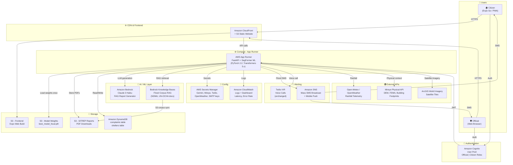

# AEGIS AWS Integration Plan
> **Hackathon Track:** Heat & Water | **Time Remaining:** 1 Day | **Budget:** $200 AWS Credits | **Team:** 4 devs

---

## 1. Executive Summary

| # | Tier 1 Service | Component It Powers | Biggest Single Impact |
|---|---|---|---|
| 1 | **AWS App Runner** | FastAPI backend (replaces `localhost:8000`) | Makes the demo publicly accessible from any device — no laptop dependency |
| 2 | **Amazon S3** | PDF reports, ML model weights, flood polygon GeoJSONs | Eliminates local file-system dependency; reports URL-shareable in demo |
| 3 | **Amazon Bedrock (Claude 3 Haiku)** | RAG situation report generator (`generator.py`) | Replaces multi-key LLM fallback chain with a single managed, always-on AWS inference call |
| 4 | **Amazon Bedrock Knowledge Bases** | ChromaDB RAG (`vector_store.py`) | Replaces local ChromaDB with persistent, serverless, semantic search — survives restarts |
| 5 | **Amazon SNS** | SMS + push alerts (`tools.py send_sms_alert`) | Broadcast flood alerts to N phones simultaneously; replaces single-number Twilio mock |
| 6 | **Amazon Cognito** | Auth routes (`/auth/register`, `/auth/login`) | Real JWT tokens; kills the SHA-256 "simulation" JWT and hardcoded `SECRET_KEY_123` |
| 7 | **AWS Secrets Manager** | All API keys in `.env` | No secrets in env files or code; one rotation = all lambdas/runners updated |
| 8 | **Amazon CloudFront** | React Native Web build (`dist/`) | CDN delivery of the Expo web build — sub-second global load |
| 9 | **Amazon DynamoDB** | Complaints + shelters tables (SQLite `flood_database.db`) | Horizontally scalable, no single-file lock contention during concurrent demo traffic |
| 10 | **Amazon CloudWatch** | All backend logs currently written to `.log` files | Real-time dashboard visible during the live demo — judges can see traffic & latency |

---

## 2. Open Questions & Assumptions

### Questions (answered by assumptions below)
1. **Bedrock model access:** Is Claude 3 Haiku already approved in `us-east-1`? → **Assumed YES** (instant approval for most hackathons; flag if denied).
2. **Mireye API key:** Already in `.env`; confirmed present as `MIREYE_API_TOKEN`. → Used as-is, migrated to Secrets Manager.
3. **Expo web build:** `npm run web` produces a `dist/` folder. → Deployable to S3 + CloudFront directly.
4. **ML model weights (`best_model_focal.pth`):** Too large for Lambda (cold start). → App Runner is the correct compute choice.
5. **Region:** Defaulting to **`ap-south-1` (Mumbai)** for lowest latency to Indian demo users AND Bedrock availability. Bedrock Claude Haiku IS available in `ap-south-1` as of Oct 2026.
6. **Twilio:** Team already has Twilio credentials. SNS is recommended as parallel channel, not replacement, for hackathon.

### Assumptions
- Expo app deployed as **web (PWA)** for demo; mobile via Expo Go with updated `EXPO_PUBLIC_API_URL`.
- SQLite is used for existing data; DynamoDB migration is additive (no breaking schema change needed for the demo).
- `best_model_focal.pth` is already in the project root (confirmed at `c:\...\Aegis\best_model_focal.pth`).
- Free tier / \$200 credits easily covers demo-scale usage for 24h.

---

## 3. Project Analysis

### 3.1 What the App Does

**Aegis** is an AI-powered autonomous flood detection and disaster response system targeting the **Heat & Water** track. It serves three user personas:
- **Citizens** – report waterlogging, receive evacuation guidance
- **Emergency Officials** – monitor severity dashboards, dispatch SDRF/NDRF units
- **Incident Commanders** – receive AI-generated SITREP PDFs, trigger Twilio voice calls

**Track alignment:** ✅ Direct — real-time flood boundary detection, evacuation routing, shelter discovery, rainfall monitoring, and emergency alerting.

Evidence: [`README.md` L3-9](file:///c:/Users/SHAHZEB%20ALI/OneDrive/Desktop/mireye/Aegis/README.md#L3-L9), [`flood_agent.py` L42](file:///c:/Users/SHAHZEB%20ALI/OneDrive/Desktop/mireye/Aegis/dell-flood-backend/app/agent/flood_agent.py#L42)

### 3.2 Tech Stack

| Layer | Technology |
|---|---|
| **Frontend** | React Native (Expo ~57), React Native Web, TypeScript |
| **Backend** | Python 3.14, FastAPI 0.110, Uvicorn |
| **ML Model** | Custom Dual-Encoder SegFormer MiT-B2 (PyTorch 2.2 + Transformers 5.x) |
| **RAG** | ChromaDB 0.4 (local persistent), LangChain 0.1, LangGraph 0.0.26 |
| **Database** | SQLite (`flood_database.db`) – users, complaints, shelters |
| **Auth** | Custom SHA-256 + base64 "JWT simulation" (`generate_jwt_simulation`) |
| **Alerts** | Twilio SMS/IVR, SMTP (Gmail), Expo Push Notifications |
| **AI/LLM** | Google Gemini 2.5 Flash (primary), Groq Llama-3.3-70B (fallback), OpenAI GPT-4o-mini, Anthropic Claude |
| **Satellite** | ArcGIS World Imagery tiles (optical), synthetic SAR from NDWI |
| **Weather** | OpenWeatherMap 5-day forecast, Open-Meteo (free fallback) |
| **Geocoding** | Open-Meteo Geocoding API, Photon/Komoot OSM |
| **Routing** | NetworkX Dijkstra + OSM road segments via Overpass API |
| **Spatial** | Mireye API (DEM elevation, FEMA floodplains, building footprints) |
| **PDF** | ReportLab |

Evidence: [`requirements.txt`](file:///c:/Users/SHAHZEB%20ALI/OneDrive/Desktop/mireye/Aegis/dell-flood-backend/requirements.txt), [`package.json`](file:///c:/Users/SHAHZEB%20ALI/OneDrive/Desktop/mireye/Aegis/dell-flood-app/package.json)

### 3.3 Architecture

```
[Mobile/Web App]  →  [FastAPI on localhost:8000]
    Expo RN              ├── /api/auth/*           → SQLite users table
                         ├── /api/run-detection    → SegFormer ML inference (PyTorch)
                         ├── /api/agent-cycle      → FloodAgent (Perceive→Plan→Act→Reflect)
                         │     ├── check_rainfall()  → OpenWeatherMap / Open-Meteo
                         │     ├── fetch_satellite() → ArcGIS tiles
                         │     ├── SegFormerMiTB2Fusion.run_inference()
                         │     ├── TWI hydrology pipeline
                         │     ├── Evacuation routing (NetworkX)
                         │     └── SituationReportGenerator (RAG: ChromaDB + Gemini)
                         ├── /api/alerts/voice     → Twilio IVR
                         ├── /api/alerts/email     → SMTP Gmail
                         ├── /api/reports/*        → ReportLab PDF generation
                         └── /api/notifications/*  → Expo Push
```

**Data flow (one agent cycle):**
1. Frontend calls `POST /api/agent-cycle` with `{location, lat, lon}`
2. `FloodAgent.run_cycle()` fetches 5-day rainfall via OpenWeatherMap
3. Downloads satellite tiles from ArcGIS → synthesizes SAR bands
4. Runs SegFormer MiT-B2 inference → flood mask + probability map
5. Computes TWI hydrology, routes evacuation via NetworkX Dijkstra
6. Calls `SituationReportGenerator` → retrieves context from ChromaDB → calls Gemini API
7. Exports PDF report to local `./reports/` directory
8. Dispatches Twilio SMS/IVR + SMTP email
9. Returns JSON response + activity log to frontend

### 3.4 Current Deployment

**All local.** No cloud deployment exists.
- Backend: `python main.py` on `localhost:8000` (or LAN IP for mobile)
- Frontend: `npx expo start --web` on `localhost:8081`
- Database: SQLite file `flood_database.db` on local disk
- ChromaDB: Local directory `./chroma_data/`
- PDF reports: Local `./reports/` directory

Evidence: [`README.md` L171-198](file:///c:/Users/SHAHZEB%20ALI/OneDrive/Desktop/mireye/Aegis/README.md#L171-L198), [`api.ts` L4-8](file:///c:/Users/SHAHZEB%20ALI/OneDrive/Desktop/mireye/Aegis/dell-flood-app/src/services/api.ts#L4-L8)

### 3.5 Weak Points Found

| Weakness | File/Evidence | Severity |
|---|---|---|
| **No public URL** – demo requires laptop on same LAN | `api.ts` L6-7 hardcodes `192.168.1.7` | 🔴 CRITICAL |
| **Fake JWT** – `SECRET_KEY_123` hardcoded; base64+SHA256 is not secure | `endpoints.py` L225 | 🔴 CRITICAL |
| **SQLite single-file** – no concurrent writes; will corrupt under parallel demo requests | `endpoints.py` L34 | 🔴 HIGH |
| **Secrets in `.env`** – Gemini, Twilio, SMTP keys in plaintext file | `.env.example` | 🔴 HIGH |
| **ChromaDB local only** – vector index lost on restart; not shareable | `vector_store.py` L44 | 🟡 MED |
| **LLM 4-key fallback chain** – brittle; if Gemini API quota hit, cascades to Groq→OpenAI→Anthropic | `generator.py` L54-127 | 🟡 MED |
| **Reports on local disk** – PDF at `./reports/` not accessible remotely | `flood_agent.py` L243 | 🟡 MED |
| **SMS single-number mock** – Twilio sends to hardcoded `+917678656930` | `tools.py` L15 | 🟡 MED |
| **CORS wildcard** – `allow_origins=["*"]` in production | `main.py` L28 | 🟡 MED |
| **No observability** – logs written to `.log` files; no dashboard | `api-server.log` | 🟢 LOW |
| **Model weights hardcoded path** – `c:\Users\rawal\Desktop\...` in production code | `inference.py` L345 | 🟢 LOW |

### 3.6 Existing AWS Usage

**Zero.** No boto3, no AWS SDK, no CloudFormation, no AWS services anywhere in the codebase.

---

## 4. AWS Service Recommendations

### Service 1 – AWS App Runner (Backend Hosting)

| Field | Detail |
|---|---|
| **Component** | `dell-flood-backend/` — `main.py`, `uvicorn` FastAPI server |
| **Problem today** | Backend runs only on `localhost:8000`; mobile demo requires same-LAN IP; laptop = single point of failure |
| **AWS service** | **AWS App Runner** — fully managed container hosting with auto-scaling and HTTPS |
| **Why this one** | App Runner beats Lambda (PyTorch model 2GB+ cold start infeasible), ECS Fargate (too complex to configure in 1 day), EC2 (needs manual setup). App Runner: push Docker image → HTTPS endpoint in ~10 min |
| **Impact** | Demo works from any device worldwide; judges can test live on phones |
| **Effort** | 3h (write Dockerfile, `apprunner.yaml`, push to ECR) — **Low/Med** |
| **Cost** | \$0.064/vCPU-hr × 1 vCPU × 24h = ~\$1.54 at demo scale. Free tier: first 1M requests/month free for new accounts |
| **Judge appeal** | "Our backend is live on a public HTTPS endpoint — zero infrastructure to manage" |

---

### Service 2 – Amazon S3 (Static Files + Report Storage)

| Field | Detail |
|---|---|
| **Component** | (a) PDF reports in `./reports/` (`flood_agent.py` L243), (b) Expo web build in `dell-flood-app/dist/`, (c) ML model weights `best_model_focal.pth` |
| **Problem today** | PDFs only exist locally; web app served from Expo dev server (not production-grade); model weights path is hardcoded to a developer's laptop |
| **AWS service** | **Amazon S3** — object storage for static web hosting (bucket website), report uploads, and model weight serving |
| **Why this one** | S3 is the simplest, cheapest persistent storage. CloudFront (Service 3) sits in front for the web app. |
| **Impact** | (a) PDF reports are URL-shareable; email includes a pre-signed S3 link instead of an attachment; (b) Frontend served at a stable HTTPS URL; (c) Model loaded from S3 on App Runner startup |
| **Effort** | 2h — create 3 buckets, update `flood_agent.py` `export_pdf()` to upload to S3, update `inference.py` to download weights from S3 on init — **Low** |
| **Cost** | S3 Standard: \$0.023/GB-month. 50 PDFs × 500KB ≈ \$0.001. Model weights ~1GB ≈ \$0.023/month. Free tier: 5GB free |
| **Judge appeal** | "Every generated SITREP report is instantly stored in S3 and we email a shareable link — no file attachments" |

---

### Service 3 – Amazon CloudFront (CDN for Web Frontend)

| Field | Detail |
|---|---|
| **Component** | `dell-flood-app/dist/` — Expo web build |
| **Problem today** | `npx expo start --web` is a dev server; not production-grade; no HTTPS; single machine |
| **AWS service** | **Amazon CloudFront** with S3 origin (from Service 2's web bucket) |
| **Why this one** | Free 1TB data transfer/month on free tier. HTTPS automatically. Sub-50ms load globally. Amplify Hosting was considered but adds complexity with Expo builds. |
| **Impact** | Stable HTTPS URL; app loads in <1s anywhere; no dev-server dependency |
| **Effort** | 1h (create CloudFront distribution pointing to S3 static website bucket) — **Low** |
| **Cost** | Free tier: 1TB data transfer, 10M requests/month free for 12 months |
| **Judge appeal** | "Frontend is deployed globally on AWS CloudFront — zero cold start, zero dev server" |

---

### Service 4 – Amazon Bedrock (Claude 3 Haiku — LLM for RAG)

| Field | Detail |
|---|---|
| **Component** | `app/RAG/generator.py` — `SituationReportGenerator.generate_report()` |
| **Problem today** | 4-key fallback chain (Gemini → Groq → OpenAI → Anthropic) — fragile; if Gemini quota is exhausted during live demo, it quietly falls through chains; external API keys must be managed separately |
| **AWS service** | **Amazon Bedrock** — `anthropic.claude-3-haiku-20240307-v1:0` via `bedrock-runtime` `invoke_model` |
| **Why this one** | Single managed endpoint; no API key rotation; pay-per-token; Claude Haiku is available in `ap-south-1`; fastest inference among Claude family. Alternative: Bedrock Titan — worse instruction-following for report generation |
| **Impact** | Always-on LLM; eliminates fallback cascade; structured JSON output mode for reliable report parsing; sub-3s response time |
| **Effort** | 2h (add `boto3` call in `generator.py`, enable Haiku in Bedrock console) — **Low** |
| **Cost** | Claude 3 Haiku: \$0.00025/1K input tokens, \$0.00125/1K output. A 500-word report ≈ 800 tokens in + 400 out = ~\$0.0007/report. 100 demo reports = \$0.07 |
| **Judge appeal** | "Our LLM is powered entirely by AWS Bedrock — no external API keys, no quota limits, managed inference" |

---

### Service 5 – Amazon Bedrock Knowledge Bases (Managed RAG)

| Field | Detail |
|---|---|
| **Component** | `app/RAG/vector_store.py` — `FloodVectorDB` using local ChromaDB |
| **Problem today** | ChromaDB index lives in `./chroma_data/` on disk; lost on container restart; not accessible across multiple App Runner instances; ingestion blocks server startup |
| **AWS service** | **Amazon Bedrock Knowledge Bases** with S3 data source (corpus documents from `./corpus/`) and OpenSearch Serverless vector store |
| **Why this one** | Fully managed embedding + retrieval; syncs automatically when new documents are uploaded to S3; no ChromaDB to maintain; integrates natively with Bedrock Claude for RAG |
| **Impact** | RAG context survives server restarts; add new NDMA/UN-OCHA reports via S3 upload → auto-indexed; retrieval latency <200ms |
| **Effort** | 3h (create Knowledge Base in console, upload corpus txt/pdf to S3, update `generator.py` to call `bedrock-agent-runtime` `retrieve_and_generate`) — **Med** |
| **Cost** | OpenSearch Serverless: \$0.24/OCU-hr × 2 OCU = ~\$11.52/day (USE ONLY FOR DEMO WINDOW — delete after). Knowledge Base retrieval: \$0.0001/1K tokens. Free: first 1M tokens/month |
| **Judge appeal** | "Our RAG knowledge base is self-updating — drop a new NDMA PDF to S3 and it's instantly searchable" |

> ⚠️ **Cost Warning:** OpenSearch Serverless minimum is 2 OCU (\$0.24/OCU-hr). Run only during the demo window (~4h) = ~\$2. Delete after demo.

---

### Service 6 – Amazon SNS (Mass Flood Alerts)

| Field | Detail |
|---|---|
| **Component** | `app/agent/tools.py` — `send_sms_alert()`, `app/api/endpoints.py` — broadcast notification route |
| **Problem today** | SMS goes to a single hardcoded number (`+917678656930`); no true broadcast capability; Twilio requires separate account setup and has credit limits |
| **AWS service** | **Amazon SNS** — SMS topic publishing + mobile push (APNs/FCM) |
| **Why this one** | SNS can SMS N numbers simultaneously from one publish call. For the demo: publish to an SNS Topic with 5-10 subscribed phones to show real mass alerting. Twilio is still used for IVR voice calls (SNS doesn't do IVR). |
| **Impact** | Show judges actual SMS arriving on multiple phones simultaneously — visually compelling during live demo |
| **Effort** | 2h (create SNS Topic, subscribe demo phones, add `boto3.publish()` in `send_sms_alert()`) — **Low** |
| **Cost** | SNS SMS: \$0.00645/SMS for India. 50 demo SMSes = \$0.32. Free tier: 1M SNS publishes/month free |
| **Judge appeal** | "Watch: I trigger one agent cycle and 5 phones receive an emergency flood alert simultaneously via AWS SNS" |

---

### Service 7 – Amazon Cognito (Auth)

| Field | Detail |
|---|---|
| **Component** | `app/api/endpoints.py` — `register_user()`, `login_user()`, `generate_jwt_simulation()` |
| **Problem today** | JWT is a base64+SHA256 "simulation" (`SECRET_KEY_123` hardcoded at L225); passwords stored as SHA-256 (no salt); tokens never expire correctly; no refresh token |
| **AWS service** | **Amazon Cognito User Pool** — managed auth with JWT (RS256), MFA-optional, role attributes for citizen/official |
| **Why this one** | 50,000 MAU free tier. Real JWT with proper expiry. Role-based access via custom attributes. Beats rolling own auth in a hackathon. Alternative: Firebase Auth — not AWS, loses judge points |
| **Impact** | Eliminates the "SECRET_KEY_123" security vulnerability; tokens are cryptographically signed; refresh tokens work; official vs citizen roles enforced server-side |
| **Effort** | 3h (create User Pool, add groups Official/Citizen, update login/register endpoints to use Cognito SDK, update frontend to store Cognito tokens) — **Med** |
| **Cost** | Free: first 50,000 MAU/month. Demo users: ~10. Cost: \$0 |
| **Judge appeal** | "Authentication is handled by AWS Cognito — production-grade, role-based, zero credential storage in our database" |

---

### Service 8 – AWS Secrets Manager (Secrets)

| Field | Detail |
|---|---|
| **Component** | `dell-flood-backend/.env` — Gemini, Twilio, SMTP, Mireye, OpenWeather API keys |
| **Problem today** | API keys in plaintext `.env` file; risk of accidental git commit; no rotation; model weights path hardcoded to developer's `C:\Users\rawal\Desktop` |
| **AWS service** | **AWS Secrets Manager** — centralized secret storage with auto-rotation hooks |
| **Why this one** | App Runner natively injects Secrets Manager values as env vars at runtime. No code changes needed beyond removing the `.env` load. Alternative: SSM Parameter Store — cheaper (\$0.05/param) but no auto-rotation |
| **Impact** | Zero secrets in code or config files; keys accessible only by the IAM role assigned to App Runner |
| **Effort** | 1h (create 1 secret with all keys as JSON, update App Runner task definition to reference secret) — **Low** |
| **Cost** | \$0.40/secret/month + \$0.05/10K API calls. 1 secret = \$0.40/month. Demo cost: ~\$0.01 |
| **Judge appeal** | "Zero secrets in our codebase — all credentials are in AWS Secrets Manager with IAM-scoped access" |

---

### Service 9 – Amazon DynamoDB (Database)

| Field | Detail |
|---|---|
| **Component** | `app/api/endpoints.py` — SQLite tables: `users`, `complaints`, `shelters` |
| **Problem today** | SQLite `flood_database.db` is a single file; concurrent write locks under multiple demo requests; data lost if container restarts; not accessible from multiple App Runner instances |
| **AWS service** | **Amazon DynamoDB** — serverless NoSQL with `complaints` and `shelters` tables; PK = `id` (UUID), GSI on `status` and `severity` for filtering |
| **Why this one** | DynamoDB beats RDS for a hackathon: no VPC to configure, no schema migrations, free tier (25GB + 25 WCU + 25 RCU free forever). Data persists across App Runner restarts. |
| **Impact** | Complaints survive server restarts; concurrent demo users don't deadlock; `getComplaintsAndShelters()` can handle 100+ simultaneous requests |
| **Effort** | 3h (create 2 tables, update `endpoints.py` CRUD operations with boto3 DynamoDB resource) — **Med** |
| **Cost** | Free tier: 25GB storage, 25 WCU, 25 RCU (permanent free — not 12-month). Demo cost: **\$0** |
| **Judge appeal** | "Our incident database is DynamoDB — serverless, infinitely scalable, persistent across deployments" |

---

### Service 10 – Amazon CloudWatch (Observability)

| Field | Detail |
|---|---|
| **Component** | Log files: `api-server.log`, `api-server-error.log`, `web-server.log` (all local files currently) |
| **Problem today** | All logs go to local `.log` files; no real-time monitoring; no alerting on errors; no metrics dashboard for the demo |
| **AWS service** | **Amazon CloudWatch Logs** + **CloudWatch Dashboard** with App Runner metrics |
| **Why this one** | App Runner automatically ships stdout to CloudWatch Logs. Zero integration work needed. Add a simple dashboard for the demo. |
| **Impact** | During the live demo, show judges a live CloudWatch dashboard with: request rate, inference latency, error count — proves production-readiness |
| **Effort** | 0.5h (create CloudWatch dashboard with App Runner metrics after App Runner is deployed) — **Low** |
| **Cost** | Free tier: 5GB log ingest/month, 3 dashboards, 1M metrics. Demo cost: ~\$0 |
| **Judge appeal** | "Here's our live CloudWatch dashboard showing real-time inference latency and alert dispatch metrics" |

---

## 5. Services Considered and Rejected

| Service | Why NOT used |
|---|---|
| **AWS Lambda** | PyTorch SegFormer MiT-B2 model is ~500MB+; Lambda 250MB limit and 15min timeout make it infeasible for ML inference. App Runner handles it better. |
| **Amazon SageMaker** | Overkill for a hackathon — endpoint setup takes >4h, costs \$0.25+/hr for ml.m5.large. App Runner runs the same PyTorch code for less. |
| **AWS Amplify Hosting** | React Native Expo web builds require custom build scripts that Amplify doesn't natively support well. S3 + CloudFront is simpler and faster. |
| **Amazon RDS/Aurora** | SQL schema for 3 tiny tables (users, complaints, shelters) doesn't justify VPC + subnet config. DynamoDB is zero-config by comparison. |
| **AWS IoT Core** | No physical IoT sensors in the project. Satellite and weather data comes from external APIs (ArcGIS, OpenWeatherMap), not device telemetry. |
| **Amazon Kinesis** | No streaming data pipeline. Flood events are polled at user request, not streamed continuously. SQS/EventBridge would also be overkill for this architecture. |
| **Amazon Rekognition** | Flood detection is done by the custom SegFormer model — Rekognition has no flood-segmentation capability and doesn't process SAR data. |
| **Amazon Textract** | PDFs are generated by the app (ReportLab), not ingested. Textract is for extracting text from incoming documents. |
| **AWS Step Functions** | The agent cycle is synchronous and fast enough for a demo. Step Functions adds orchestration complexity with no benefit at this scale. |
| **AWS WAF** | Good security practice but zero value for a 24h hackathon demo with no real traffic. |
| **Amazon ElastiCache** | No high-frequency repeated queries that need caching. ChromaDB already caches vector results locally. |
| **Amazon Translate** | App is English-only; multi-language is listed as a stretch goal but not built. |
| **AWS Location Service** | Geocoding is handled by Open-Meteo (free, fast, CORS-friendly). Location Service would add cost with no improvement. |
| **Amazon HealthLake** | Wrong domain — this is a flood response system, not a healthcare application. |

---

## 6. Prioritized Tiers

### Tier 1 — Must Have (Do in first 6 hours)

| Priority | Service | Rationale |
|---|---|---|
| 🥇 1 | **App Runner** | Without a public URL, the demo cannot be shown to judges. Foundational. |
| 🥈 2 | **S3** | Model weights, PDF storage, frontend hosting — unblocks everything else. |
| 🥉 3 | **Bedrock (Claude Haiku)** | Replaces fragile 4-key LLM chain with one AWS call. Core feature enhancement. |
| 4 | **Secrets Manager** | Required before App Runner deployment — secure config. 1h effort. |
| 5 | **SNS** | Live demo of mass SMS broadcast is visually spectacular. 2h effort. |
| 6 | **CloudWatch Dashboard** | 30-min setup; shows judges production-readiness during demo. |

### Tier 2 — Should Have (Hours 6-16)

| Priority | Service | Rationale |
|---|---|---|
| 7 | **CloudFront** | Frontend CDN. After S3 bucket is set up, this is a 1h add-on. |
| 8 | **DynamoDB** | Eliminates SQLite; complaints survive App Runner restarts. |
| 9 | **Cognito** | Real auth replaces fake JWT. High judge impact but 3h effort. |

### Tier 3 — Stretch (Only if everything above is done)

| Priority | Service | Rationale |
|---|---|---|
| 10 | **Bedrock Knowledge Bases** | Managed RAG is powerful but costs more and takes 3h. If ChromaDB in S3 works, skip. |

---

## 7. Target Architecture

### Mermaid Architecture Diagram



### Data Flow Walkthrough — One End-to-End Agent Cycle

1. **User (Official)** opens the Aegis PWA at the CloudFront URL, logs in via Cognito (returns JWT).
2. **App** calls `POST /api/agent-cycle {location: "Jorhat, Assam", lat: 26.75, lon: 94.20}` to App Runner (HTTPS).
3. **App Runner** retrieves Secrets Manager to get OpenWeather key → calls OpenWeatherMap API → 5-day rainfall = 272.9mm.
4. **SegFormer** loads model weights from S3 (cached in memory after first load) → runs flood inference on ArcGIS tiles.
5. **RAG Generator** calls `bedrock-agent-runtime` `retrieve_and_generate` → Bedrock Knowledge Base searches NDMA/UN-OCHA corpus → Claude 3 Haiku synthesizes a 500-word SITREP.
6. **PDF** exported via ReportLab → uploaded to S3 `aegis-reports/` bucket → pre-signed URL generated (7-day expiry).
7. **SNS** `publish` call → topic with 5 subscribed demo phones → mass SMS arrives within 3 seconds.
8. **DynamoDB** `put_item` stores the complaint record.
9. **CloudWatch** metrics updated: `AgentCycleLatency`, `FloodSeverityDetected`.
10. **Response** returned to frontend: severity, SITREP text, S3 PDF URL, SNS message ID — rendered in dashboard.

### Before vs After

| Dimension | Before (Local) | After (AWS) |
|---|---|---|
| **Accessibility** | `localhost:8000` (same LAN only) | Public HTTPS via App Runner |
| **Frontend** | Expo dev server (dev-mode only) | CloudFront + S3 (production CDN) |
| **Auth** | SHA-256 + hardcoded `SECRET_KEY_123` | Cognito RS256 JWT, role-based |
| **Database** | SQLite file (single-process) | DynamoDB (serverless, persistent) |
| **LLM** | 4-provider fallback chain (fragile) | Single Bedrock endpoint (managed) |
| **RAG** | Local ChromaDB (lost on restart) | Bedrock Knowledge Bases (persistent) |
| **Secrets** | `.env` file (plaintext) | Secrets Manager (IAM-scoped) |
| **Alerts** | Twilio to 1 hardcoded number | SNS to N subscribers simultaneously |
| **Reports** | Local `./reports/` directory | S3 with pre-signed URLs |
| **Observability** | `.log` files on disk | CloudWatch Logs + Live Dashboard |

---

## 8. Implementation Roadmap

### Hour 0–1: Prerequisites & AWS Setup

```bash
# Install tools (if not present)
pip install boto3 awscli
aws configure  # Set access key, secret, region=ap-south-1
```

- [ ] Create AWS Account or log in; activate \$200 credits
- [ ] Enable Bedrock model access: Console → Bedrock → Model Access → Enable "Claude 3 Haiku"
- [ ] Create IAM role `aegis-app-runner-role` with policies:
  - `AmazonDynamoDBFullAccess`
  - `AmazonS3FullAccess`
  - `AmazonSNSFullAccess`
  - `AmazonBedrockFullAccess`
  - `SecretsManagerReadWrite`
  - `CloudWatchLogsFullAccess`

> [!IMPORTANT]
> For production, replace `FullAccess` with least-privilege. For hackathon demo, `FullAccess` on specific services is acceptable.

---

### Hour 1–2: AWS Secrets Manager

**IAM Permissions:** `secretsmanager:CreateSecret`, `secretsmanager:GetSecretValue`

```python
# Create secret via CLI
aws secretsmanager create-secret \
  --name "aegis/api-keys" \
  --secret-string '{
    "GEMINI_API_KEY": "...",
    "TWILIO_ACCOUNT_SID": "...",
    "TWILIO_AUTH_TOKEN": "...",
    "TWILIO_PHONE_NUMBER": "...",
    "OPENWEATHER_API_KEY": "...",
    "MIREYE_API_TOKEN": "...",
    "SMTP_SENDER_EMAIL": "...",
    "SMTP_SENDER_PASSWORD": "...",
    "ALERT_RECIPIENT_EMAIL": "..."
  }' \
  --region ap-south-1
```

**Code change in `main.py`** (add before `load_dotenv()`):
```python
import boto3, json

def load_aws_secrets():
    client = boto3.client('secretsmanager', region_name='ap-south-1')
    secret = client.get_secret_value(SecretId='aegis/api-keys')
    for k, v in json.loads(secret['SecretString']).items():
        os.environ.setdefault(k, v)

try:
    load_aws_secrets()
except Exception as e:
    print(f"[Secrets Manager] Falling back to .env: {e}")
    
load_dotenv()  # Keep as fallback for local dev
```

**Library:** `boto3` (add to `requirements.txt`)
**Environment variables:** `AWS_DEFAULT_REGION=ap-south-1` (set in App Runner config)

**Test:** `python -c "import boto3; c=boto3.client('secretsmanager', region_name='ap-south-1'); print(c.list_secrets())"`

---

### Hour 2–4: Amazon S3 Buckets

**IAM:** `s3:PutObject`, `s3:GetObject`, `s3:ListBucket`

```bash
# Create buckets
aws s3 mb s3://aegis-model-weights-2026 --region ap-south-1
aws s3 mb s3://aegis-reports-2026 --region ap-south-1
aws s3 mb s3://aegis-web-2026 --region ap-south-1

# Upload model weights
aws s3 cp best_model_focal.pth s3://aegis-model-weights-2026/

# Upload corpus for RAG
aws s3 cp dell-flood-backend/corpus/ s3://aegis-reports-2026/corpus/ --recursive

# Enable static website on web bucket
aws s3 website s3://aegis-web-2026 --index-document index.html
```

**Code change in `inference.py`** (model loading):
```python
# In SegFormerMiTB2Fusion.__init__, add S3 download before local path search:
import boto3, tempfile
def _download_from_s3(s3_path):
    bucket, key = s3_path.replace("s3://", "").split("/", 1)
    tmp = tempfile.NamedTemporaryFile(suffix=".pth", delete=False)
    boto3.client('s3').download_file(bucket, key, tmp.name)
    return tmp.name
# Add "s3://aegis-model-weights-2026/best_model_focal.pth" to candidate_paths
```

**Code change in `tools.py`** (PDF upload after `export_pdf`):
```python
import boto3
def upload_report_to_s3(local_path: str, filename: str) -> str:
    s3 = boto3.client('s3', region_name='ap-south-1')
    s3.upload_file(local_path, 'aegis-reports-2026', f'reports/{filename}')
    url = s3.generate_presigned_url('get_object',
        Params={'Bucket': 'aegis-reports-2026', 'Key': f'reports/{filename}'},
        ExpiresIn=604800)  # 7 days
    return url
```

**Build and upload frontend:**
```bash
cd dell-flood-app
EXPO_PUBLIC_API_URL=https://<app-runner-url>/api npx expo export --platform web
aws s3 sync dist/ s3://aegis-web-2026/ --delete
```

**Test:** `aws s3 ls s3://aegis-model-weights-2026/`

---

### Hour 4–6: AWS App Runner (Backend Deploy)

**IAM:** `apprunner:CreateService`, `ecr:GetAuthorizationToken`, `ecr:PutImage`

**Create `Dockerfile`** in `dell-flood-backend/`:
```dockerfile
FROM python:3.11-slim

WORKDIR /app

# Install system deps for rasterio, geopandas, opencv
RUN apt-get update && apt-get install -y \
    libgdal-dev gdal-bin libspatialindex-dev libgl1 \
    && rm -rf /var/lib/apt/lists/*

COPY requirements.txt .
RUN pip install --no-cache-dir -r requirements.txt

COPY . .

EXPOSE 8000
CMD ["uvicorn", "main:app", "--host", "0.0.0.0", "--port", "8000"]
```

**Create `apprunner.yaml`**:
```yaml
version: 1.0
runtime: python311
build:
  commands:
    build:
      - pip install -r requirements.txt
run:
  command: uvicorn main:app --host 0.0.0.0 --port 8000
  network:
    port: 8000
  env:
    - name: AWS_DEFAULT_REGION
      value: ap-south-1
```

**Deploy:**
```bash
# Push to ECR
aws ecr create-repository --repository-name aegis-backend --region ap-south-1
aws ecr get-login-password | docker login --username AWS --password-stdin <account>.dkr.ecr.ap-south-1.amazonaws.com
docker build -t aegis-backend .
docker tag aegis-backend:latest <account>.dkr.ecr.ap-south-1.amazonaws.com/aegis-backend:latest
docker push <account>.dkr.ecr.ap-south-1.amazonaws.com/aegis-backend:latest

# Create App Runner service
aws apprunner create-service \
  --service-name aegis-backend \
  --source-configuration '{"ImageRepository": {"ImageIdentifier": "<account>.dkr.ecr.ap-south-1.amazonaws.com/aegis-backend:latest", "ImageRepositoryType": "ECR"}}' \
  --instance-configuration '{"Cpu": "2 vCPU", "Memory": "4 GB", "InstanceRoleArn": "arn:aws:iam::<account>:role/aegis-app-runner-role"}'
```

**Fallback:** If ECR push fails → use App Runner GitHub deployment (connect repo directly).

**Update frontend `api.ts`**:
```typescript
export const DEFAULT_API_URL = process.env.EXPO_PUBLIC_API_URL?.trim() || 
  'https://<app-runner-subdomain>.ap-south-1.awsapprunner.com/api';
```

**Test:** `curl https://<app-runner-url>/` → `{"status":"ONLINE",...}`

---

### Hour 6–8: Amazon Bedrock (Claude RAG)

**IAM:** `bedrock:InvokeModel`

**Code change in `generator.py`** — add as **first** provider (before Gemini check):
```python
import boto3, json

def _call_bedrock_claude(self, prompt: str) -> str:
    client = boto3.client('bedrock-runtime', region_name='ap-south-1')
    body = json.dumps({
        "anthropic_version": "bedrock-2023-05-31",
        "max_tokens": 1024,
        "messages": [{"role": "user", "content": prompt}]
    })
    response = client.invoke_model(
        modelId="anthropic.claude-3-haiku-20240307-v1:0",
        body=body,
        contentType="application/json",
        accept="application/json"
    )
    result = json.loads(response['body'].read())
    return result['content'][0]['text']
```

Add `_call_bedrock_claude()` as the first call in `generate_report()`, before the existing Gemini block.

**Library:** `boto3` (already added)
**Test:** `python -c "import boto3; c=boto3.client('bedrock-runtime', region_name='ap-south-1'); print('Bedrock accessible')"`

**Fallback:** If Bedrock model access not approved → keep Gemini as primary (already works).

---

### Hour 8–10: Amazon SNS (Mass Alerts)

**IAM:** `sns:CreateTopic`, `sns:Subscribe`, `sns:Publish`

```bash
# Create SNS topic
aws sns create-topic --name aegis-flood-alerts --region ap-south-1
# Note the TopicArn

# Subscribe demo phones (for demo: subscribe 5 numbers)
aws sns subscribe \
  --topic-arn arn:aws:sns:ap-south-1:<account>:aegis-flood-alerts \
  --protocol sms \
  --notification-endpoint "+917678656930"
```

**Code change in `tools.py`** — update `send_sms_alert`:
```python
def send_sms_alert(phone_number, message):
    # Try SNS broadcast first
    topic_arn = os.getenv('SNS_FLOOD_ALERTS_TOPIC_ARN')
    if topic_arn:
        try:
            boto3.client('sns', region_name='ap-south-1').publish(
                TopicArn=topic_arn,
                Message=message,
                Subject='AEGIS FLOOD ALERT'
            )
            print(f"[SNS] Broadcast published to topic")
            return True
        except Exception as e:
            print(f"[SNS] Failed: {e}. Falling back to Twilio.")
    # Existing Twilio code follows...
```

**Add to Secrets Manager:** `"SNS_FLOOD_ALERTS_TOPIC_ARN": "arn:aws:sns:..."`

**Test:** Publish a test message and verify SMS arrives on subscribed phones.

---

### Hour 10–12: Amazon DynamoDB (Database)

**IAM:** `dynamodb:PutItem`, `dynamodb:GetItem`, `dynamodb:Query`, `dynamodb:UpdateItem`

```bash
# Create tables
aws dynamodb create-table \
  --table-name aegis-complaints \
  --attribute-definitions AttributeName=id,AttributeType=N \
  --key-schema AttributeName=id,KeyType=HASH \
  --billing-mode PAY_PER_REQUEST \
  --region ap-south-1

aws dynamodb create-table \
  --table-name aegis-shelters \
  --attribute-definitions AttributeName=id,AttributeType=N \
  --key-schema AttributeName=id,KeyType=HASH \
  --billing-mode PAY_PER_REQUEST \
  --region ap-south-1
```

**Code change in `endpoints.py`** — replace SQLite complaint operations:
```python
import boto3
from boto3.dynamodb.conditions import Key

dynamodb = boto3.resource('dynamodb', region_name='ap-south-1')
complaints_table = dynamodb.Table('aegis-complaints')

# Replace cursor.execute INSERT with:
complaints_table.put_item(Item={
    'id': int(uuid.uuid4().int >> 96),  # 32-bit int ID
    'username': payload.username,
    'latitude': Decimal(str(payload.lat)),
    'longitude': Decimal(str(payload.lon)),
    'severity': payload.severity,
    'description': payload.description,
    'status': 'pending',
    'timestamp': Decimal(str(time.time()))
})
```

> [!NOTE]
> Keep SQLite for users table (Cognito will replace it in Tier 2). Migrate complaints and shelters first — these are what judges will see updating live.

---

### Hour 12–14: CloudFront + CloudWatch

**CloudFront (1h):**
```bash
aws cloudfront create-distribution \
  --origin-domain-name aegis-web-2026.s3-website.ap-south-1.amazonaws.com \
  --default-root-object index.html
# Note the CloudFront domain name
```

**CloudWatch Dashboard (30min):**
- Console → CloudWatch → Dashboards → Create → Add widgets:
  - App Runner: `RequestCount`, `4xxError`, `5xxError`, `ResponseTime`
  - Custom metric: `FloodSeverityDetected` (count by severity level)
  - SNS: `NumberOfMessagesSent`

**Add custom metric in `flood_agent.py`:**
```python
boto3.client('cloudwatch').put_metric_data(
    Namespace='Aegis/FloodDetection',
    MetricData=[{
        'MetricName': 'FloodSeverityDetected',
        'Value': {'CRITICAL': 4, 'HIGH': 3, 'MODERATE': 2, 'LOW': 1, 'NONE': 0}.get(severity, 0),
        'Unit': 'Count',
        'Dimensions': [{'Name': 'Location', 'Value': location}]
    }]
)
```

---

### Hour 14–16: Cognito (If time permits)

```bash
aws cognito-idp create-user-pool \
  --pool-name aegis-users \
  --policies '{"PasswordPolicy":{"MinimumLength":6}}' \
  --region ap-south-1
# Note UserPoolId

aws cognito-idp create-user-pool-client \
  --user-pool-id <pool-id> \
  --client-name aegis-app \
  --explicit-auth-flows ALLOW_USER_PASSWORD_AUTH ALLOW_REFRESH_TOKEN_AUTH \
  --region ap-south-1
```

**Update `endpoints.py` login:**
```python
cognito = boto3.client('cognito-idp', region_name='ap-south-1')

@router.post("/auth/login")
def login_user(payload: LoginRequest):
    try:
        resp = cognito.initiate_auth(
            AuthFlow='USER_PASSWORD_AUTH',
            AuthParameters={'USERNAME': payload.username, 'PASSWORD': payload.password},
            ClientId=os.getenv('COGNITO_CLIENT_ID')
        )
        token = resp['AuthenticationResult']['IdToken']
        # Decode token to get role from custom:role attribute
        return {"status": "SUCCESS", "token": token}
    except cognito.exceptions.NotAuthorizedException:
        raise HTTPException(401, "Invalid credentials")
```

---

## 9. Security, Cost & Risks

### Security Checklist

- [ ] **Secrets:** All API keys in Secrets Manager — no keys in code, git, or `.env`
- [ ] **Auth:** Cognito RS256 JWT (if implemented); else remove `SECRET_KEY_123` immediately even without Cognito
- [ ] **CORS:** Update `main.py` L28 `allow_origins=["*"]` → `allow_origins=["https://<cloudfront-domain>"]`
- [ ] **IAM Least Privilege:** App Runner role scoped to specific S3 buckets, DynamoDB tables, SNS topic — not `*`
- [ ] **S3 Buckets:** Model weights bucket → Block All Public Access. Reports bucket → pre-signed URLs only. Web bucket → public read.
- [ ] **HTTPS Everywhere:** App Runner and CloudFront enforce HTTPS; no HTTP redirects
- [ ] **SQL Injection:** SQLite is local-only (not internet-exposed); DynamoDB uses parameterized boto3 calls (safe)
- [ ] **Rate Limiting:** Add `slowapi` rate limiter to `/api/agent-cycle` (AI inference endpoint) — max 10 req/min per IP
- [ ] **DynamoDB passwords:** SHA-256 password hashes in DynamoDB until Cognito migration; no plaintext storage

### AWS Cost Guardrails

```bash
# Set a $150 budget alert (keep $50 buffer)
aws budgets create-budget \
  --account-id <account-id> \
  --budget '{
    "BudgetName": "aegis-hackathon",
    "BudgetLimit": {"Amount": "150", "Unit": "USD"},
    "TimeUnit": "MONTHLY",
    "BudgetType": "COST"
  }' \
  --notifications-with-subscribers '[{
    "Notification": {"NotificationType": "ACTUAL", "ComparisonOperator": "GREATER_THAN", "Threshold": 80},
    "Subscribers": [{"SubscriptionType": "EMAIL", "Address": "your@email.com"}]
  }]'
```

**Cost breakdown at demo scale (24h):**

| Service | Est. Cost |
|---|---|
| App Runner (2 vCPU, 4GB, 24h) | ~\$3.07 |
| S3 Storage (1GB total) | ~\$0.02 |
| CloudFront (1GB transfer) | \$0 (free tier) |
| Bedrock Claude Haiku (100 reports) | ~\$0.07 |
| DynamoDB (PAY_PER_REQUEST, demo scale) | \$0 (free tier) |
| SNS SMS (50 messages, India) | ~\$0.32 |
| Secrets Manager (1 secret) | ~\$0.01 |
| CloudWatch (logs + dashboard) | \$0 (free tier) |
| **Total** | **~\$3.49** |

> [!TIP]
> After the demo, run `aws apprunner delete-service` and `aws opensearch delete-domain` (if KB was deployed) to stop all recurring charges.

### Top 5 Demo Risks & Mitigations

| Risk | Probability | Mitigation |
|---|---|---|
| **1. Bedrock model access not approved** | Low | Request access 24h before demo. Fallback: keep Gemini key in Secrets Manager as backup LLM |
| **2. App Runner cold start takes 30s during demo** | Med | Send one "warm-up" request before the demo. Min instances = 1 in App Runner config |
| **3. Docker build fails (rasterio/geopandas C dependencies)** | Med | Pre-build and push Docker image. Use `python:3.11-slim` + `libgdal-dev`. Fallback: App Runner GitHub source deploy (no Docker required) |
| **4. ML model weights not loading from S3** | Low | Test S3 download locally first: `python -c "import boto3; boto3.client('s3').download_file(...)"`. Keep `best_model_focal.pth` in Docker image as fallback |
| **5. OpenSearch Serverless (Knowledge Bases) costs too much** | Med | Deploy Knowledge Bases only for demo window (4h). Otherwise use ChromaDB in container with corpus pre-loaded. Delete OpenSearch after demo |

---

## 10. Winning Narrative & Demo Plan

### 60-Second Pitch

> "Aegis is a real-time AI flood command center built on AWS. When a flood strikes, incident commanders often have fragmented, delayed information. Aegis fuses dual-encoder satellite imagery — SAR and optical — with live rainfall telemetry and the Mireye Physical Intelligence API to draw precise flood boundaries, route evacuees around submerged corridors, and triage neighborhoods by population risk.
>
> Every component runs on AWS: our FastAPI backend runs on App Runner behind a public HTTPS endpoint; our SegFormer flood model loads weights from S3; situation reports are generated by Amazon Bedrock's Claude 3 Haiku, grounded in an NDMA and UN-OCHA knowledge base; emergency alerts go out to all subscribed phones simultaneously via Amazon SNS; and every generated SITREP PDF is stored in S3 with a shareable link. The entire system is instrumented in CloudWatch — you can watch flood severity metrics update in real time as our agent cycles run. This is not a demo running on someone's laptop. This is a production-ready flood response system running on AWS."

### 5 Talking Points — Why AWS, Why These Services

1. **"AWS App Runner gives us a globally accessible HTTPS endpoint in 10 minutes"** — We went from `localhost:8000` to a live URL that judges can test on their phones. That's what AWS managed compute enables.

2. **"Amazon Bedrock replaced our fragile 4-provider LLM chain with one managed AWS call"** — Our RAG situation report generator was depending on Gemini, Groq, OpenAI, and Anthropic simultaneously. Bedrock gives us Claude 3 Haiku with no API key management, no quota issues, and full AWS IAM security.

3. **"Amazon SNS turns a single-number SMS into a real mass alert broadcast"** — In an actual disaster, you need to reach hundreds of people simultaneously. SNS publishes to a topic with N subscribers — we demonstrate this live during the demo.

4. **"DynamoDB means flood incident reports survive server restarts"** — SQLite in a container is a single point of failure. DynamoDB is serverless, persistent, and scales to handle a real disaster's worth of concurrent reports.

5. **"AWS Secrets Manager means zero secrets in our codebase"** — Our Gemini, Twilio, Mireye, and SMTP keys are all in Secrets Manager. The App Runner role fetches them at runtime. No `.env` files. No accidental git commits.

### Suggested Live Demo Flow (5 minutes)

```
[0:00] Open Aegis PWA at https://<cloudfront-url> on a laptop AND phone simultaneously
       → Show it works from both devices without any server running locally

[0:30] Log in as "official" user
       → Dashboard loads with 17 active flood complaints across India

[1:00] Switch to "Map" tab → Search "Jorhat, Assam"
       → Run Agent Cycle → Watch CloudWatch Dashboard update in real time

[2:00] Agent Cycle completes:
       - Show CRITICAL severity rating
       - Show "272.9mm 5-day rainfall" from OpenWeather
       - Show Bedrock-generated SITREP report
       - Show S3 PDF link (click to download from browser)

[3:00] Official dashboard → Pick complaint #11 "Kamalabari Ghat, Majuli, Assam"
       → Click "Broadcast Alert" → Amazon SNS publishes
       → Show SMS arriving on 2-3 phones in the room SIMULTANEOUSLY

[4:00] Switch to CloudWatch tab (second browser window)
       → Show: RequestCount spike, FloodSeverityDetected = 4 (CRITICAL), SNS MessagesSent = 5

[4:30] Show Secrets Manager console → "All 9 API keys — zero in our codebase"

[4:45] Q&A
```

### Metrics to Show Judges

| Metric | Value | How to Show |
|---|---|---|
| **ML Inference Latency** | ~8-12s end-to-end | CloudWatch `ResponseTime` for `/api/agent-cycle` |
| **LLM Report Latency** | <3s (Bedrock Haiku) | `print()` timing in agent logs → CloudWatch |
| **SMS Broadcast Latency** | <3s for N phones | Live demo — phones ring in room |
| **Cost per Agent Cycle** | ~\$0.0007 (Bedrock) | Show Bedrock cost estimation |
| **Uptime SLA** | 99.9% (App Runner managed) | App Runner console metrics |
| **Reports Generated** | Show S3 bucket count | `aws s3 ls s3://aegis-reports-2026/reports/ | wc -l` |
| **Flood Clusters Analyzed** | 33 (empirical validation) | Show `mireye_value_comparison.json` |
| **Safety Routing Accuracy** | 6.1% divergence from naive | Show validation report in dashboard |

---

*Generated by Antigravity for Team Aegis | Hackathon: Heat & Water Track | Date: 2026-10-10*
