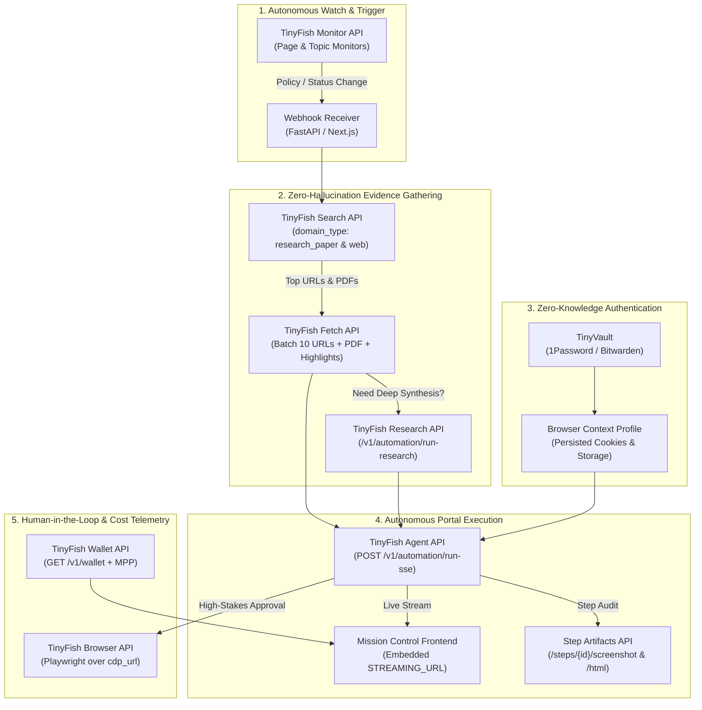

# TinyFish.ai — High-Impact Hackathon Ideas & Winning Blueprint

> **Goal:** Move beyond basic "scrape a webpage and summarize it with an LLM" projects. This document presents **5 deep, technical, hackathon-winning architectures** that leverage **6 to 9 TinyFish services simultaneously**, followed by a complete **Winning Blueprint** designed to maximize judge impact during a 3-minute live demo.

---

## Table of Contents

1. [Why Basic Ideas Lose (And What Wins a TinyFish Hack)](#1-why-basic-ideas-lose-and-what-wins-a-tinyfish-hack)
2. [Comparison Matrix: 5 Extensive TinyFish Project Ideas](#2-comparison-matrix-5-extensive-tinyfish-project-ideas)
3. [The 5 High-Impact Project Ideas (Detailed Breakdown)](#3-the-5-high-impact-project-ideas-detailed-breakdown)
   - [Idea 1 (Recommended Winner): Aegis-Flow — Autonomous Legacy Portal & Compliance Autopilot](#idea-1-recommended-winner-aegis-flow--autonomous-legacy-portal--compliance-autopilot)
   - [Idea 2: GeoPulse Sentinel — Multi-Region Checkout, Localization & Price-Parity Auditor](#idea-2-geopulse-sentinel--multi-region-checkout-localization--price-parity-auditor)
   - [Idea 3: VeriChain OSINT — Autonomous Global Vendor & Supply-Chain Due-Diligence Engine](#idea-3-verichain-osint--autonomous-global-vendor--supply-chain-due-diligence-engine)
   - [Idea 4: ChaosHealer — Self-Healing E2E QA & Autonomous Bug-Reproduction Agent](#idea-4-chaoshealer--self-healing-e2e-qa--autonomous-bug-reproduction-agent)
   - [Idea 5: GrantHunter Pro — Autonomous RFP Discovery, Eligibility Research & Portal Applicator](#idea-5-granthunter-pro--autonomous-rfp-discovery-eligibility-research--portal-applicator)
4. [The Ultimate Winning Blueprint: Building "Aegis-Flow"](#4-the-ultimate-winning-blueprint-building-aegis-flow)
   - [4.1 System Architecture & Data Flow](#41-system-architecture--data-flow)
   - [4.2 How Every TinyFish Service Is Used (Step-by-Step API Pipeline)](#42-how-every-tinyfish-service-is-used-step-by-step-api-pipeline)
   - [4.3 The "Judge-Hook" UI: Live Multi-Browser Mission Control](#43-the-judge-hook-ui-live-multi-browser-mission-control)
   - [4.4 Core Implementation Blueprint (Python Backend Orchestrator)](#44-core-implementation-blueprint-python-backend-orchestrator)
   - [4.5 The 3-Minute Winning Pitch & Live Demo Script](#45-the-3-minute-winning-pitch--live-demo-script)

---

## 1. Why Basic Ideas Lose (And What Wins a TinyFish Hack)

At any AI hackathon, 80% of teams will build a thin wrapper: *"Enter a URL or topic → call one API → pass text to OpenAI → render Markdown in a chat box."*

Judges immediately forget those projects because they **treat TinyFish like a simple HTTP scraper** rather than **enterprise web infrastructure for autonomous agents**.

To win 1st place, your project must showcase **four things that only TinyFish can do**:

1. **Closed-Loop Read + Write Action:** Don't just *read* the web (`Search` + `Fetch`); use that intelligence to *act* on the web (`Agent` + `Browser`) inside complex, stateful workflows.
2. **Authenticated & Protected Web Access:** Show agents operating behind login walls using **TinyVault** (`use_vault: true`) and **Browser Context Profiles** (`use_profile: true`), and bypassing bot protection with **Stealth Profiles** (`browser_profile: "stealth"`) and **Geo-Proxies** (`proxy_config`).
3. **Visual "Mission Control" Live Demo:** Embed the `STREAMING_URL` emitted by `POST /v1/automation/run-sse` directly into your UI so judges can **watch live cloud browsers navigating in real time**, paired with **Step Screenshots** (`GET /v1/runs/{id}/steps/{stepId}/screenshot`) as an immutable audit trail.
4. **Autonomous Triggers & Cost Telemetry:** Start workflows automatically via **Monitor API** + **Webhooks**, and display real-time unit economics (`$0.016/step` vs human labor cost) using the **Wallet API** (`GET /v1/wallet`).

---

## 2. Comparison Matrix: 5 Extensive TinyFish Project Ideas

| TinyFish Service / Feature | **1. Aegis-Flow** *(Legacy Portal Autopilot)* | **2. GeoPulse** *(Multi-Region Auditor)* | **3. VeriChain** *(Supply-Chain OSINT)* | **4. ChaosHealer** *(Self-Healing QA)* | **5. GrantHunter** *(RFP Applicator)* |
| :--- | :---: | :---: | :---: | :---: | :---: |
| **Search API** (`web`, `news`, `research_paper`) | ✅ (`web` + `research_paper`) | ✅ (Geo-localized `location`) | ✅ (All 3 `domain_type`s) | ❌ | ✅ (`web` + `research_paper`) |
| **Fetch API** (Batch, CSS Scope, PDF, ETag, `highlights`) | ✅ (PDFs + `highlights`) | ✅ (Batch + CSS Scope) | ✅ (`highlights` + Batch) | ✅ (Docs / PR context) | ✅ (PDFs + Conditional ETag) |
| **Agent API** (`/run-sse`, `/run-async`, `/run-batch`) | ✅ (`/run-sse` + `output_schema`) | ✅ (`/run-batch` + `/run-sse`) | ✅ (`/run-sse` + `stealth`) | ✅ (`mode: "strict"`) | ✅ (`/run-sse` form filling) |
| **Live Browser Stream** (`STREAMING_URL` embed) | ✅ (Dual live view) | ✅ (4-way split screen) | ✅ (Registry traversal view) | ✅ (Live test replay) | ✅ (Live form-fill preview) |
| **Step Artifacts** (`screenshots`, `html` snapshots) | ✅ (Compliance audit trail) | ✅ (Visual proof of bugs) | ✅ (Evidence archival) | ✅ (DOM diff + screenshots) | ✅ (Submission receipt) |
| **Browser API** (Playwright over `cdp_url`) | ✅ (Human-in-loop takeover) | ✅ (Network/cookie inspection) | ❌ | ✅ (DOM selector healer) | ✅ (Final human review) |
| **Research API** (`/v1/automation/run-research`) | ✅ (Cited clinical/policy brief) | ❌ | ✅ (Deep entity dossier) | ❌ | ✅ (Proposal evidence synthesis) |
| **Monitor API** (Page & Topic Monitors) | ✅ (Portal status + policy watch) | ✅ (24/7 price/checkout watch) | ✅ (Continuous vendor watch) | ✅ (Staging site watch) | ✅ (New grant/RFP alerts) |
| **TinyVault & Context Profiles** (`use_vault`, `use_profile`) | ✅ (Zero-knowledge portal login) | ✅ (Regional user personas) | ✅ (Gated registry logins) | ✅ (Test user personas) | ✅ (Applicant portal logins) |
| **Webhooks & Wallet API** (`webhook_url`, `/v1/wallet`) | ✅ (Async alerts + ROI meter) | ✅ (Alerting + cost tracker) | ✅ (Dossier completion hook) | ✅ (CI/CD webhook trigger) | ✅ (Deadline & run hooks) |
| **MCP / CLI Integration** | Optional | Optional | ✅ (Claude/Cursor analyst tool) | ✅ (Trigger from IDE via MCP) | Optional |
| **Total TinyFish Services Used** | **10 / 11** | **9 / 11** | **9 / 11** | **8 / 11** | **10 / 11** |

---

## 3. The 5 High-Impact Project Ideas (Detailed Breakdown)

---

### Idea 1 (Recommended Winner): Aegis-Flow — Autonomous Legacy Portal & Compliance Autopilot

#### The Real-World Problem
In healthcare (insurance prior authorizations), logistics (customs clearance), and B2B operations (vendor compliance portals), trillions of dollars of workflows are trapped inside **1990s-style web portals that have no APIs**.
To submit a single healthcare prior-authorization or customs filing, an operator must:
1. Check if the payer/government policy changed on a public website.
2. Search academic/clinical literature or regulatory tables to justify the request.
3. Read a 30-page PDF guideline to pull exact verbatim policy clauses.
4. Log into a password-protected, 2FA-guarded portal.
5. Click through 8 pages of forms, upload justifications, and capture screenshots of every step for legal compliance.

#### Why This Idea Wins
It turns a 45-minute manual enterprise ordeal into a **90-second autonomous workflow** that judges can watch live. Better yet, it introduces **"Seamless CDP Human-in-the-Loop Handoff"**: when the agent reaches a high-stakes step (e.g., *"Click Final Legal Sign-Off"* or an unexpected token prompt), it pauses or hands over a live **Browser API (`cdp_url`)** session so the human can click approve without losing the browser state.

#### TinyFish Services Used
1. **Monitor API (`Page Monitor`):** Watches the insurance payer's or customs authority's policy bulletin URL (`ttl: 0`). When rules change, fires a **Webhook** to your backend.
2. **Search API (`domain_type: "research_paper"` & `"web"`, `purpose`):** Finds peer-reviewed clinical studies (`pub_year_min: 2023`) or regulatory precedents supporting the case, returning `pdf_url` and `cited_by_count`.
3. **Fetch API (`highlights` Beta + PDF extraction):** Fetches the official policy manual and uses `highlights` (`query: "medical necessity criteria for..."`, `max_snippets: 5`) to extract **100% verbatim, non-hallucinated quotes** required for legal compliance.
4. **Research API (`/v1/automation/run-research`):** Synthesizes the clinical facts, verbatim policy highlights, and patient/shipment data into a cited appeal/justification packet.
5. **TinyVault (`use_vault: true`, `credential_item_ids`) + Browser Context Profiles (`use_profile: true`):** Authenticates into the target portal using 1Password/Bitwarden credentials without the LLM ever seeing the password, reusing saved session cookies.
6. **Agent API (`/v1/automation/run-sse` + `output_schema` + `capture_config`):** Navigates the multi-page portal form, fills in the structured data, and streams live `PROGRESS` events and `STREAMING_URL` to the frontend dashboard.
7. **Step Screenshots & HTML Snapshots (`GET /v1/runs/{id}/steps/{stepId}/screenshot` & `/html`):** Automatically downloads visual and DOM proof of every single form page filled out to generate a tamper-evident **Compliance Audit PDF**.
8. **Browser API (`POST https://api.browser.tinyfish.ai` + Profile Setup Session):** Allows an operator to open a live interactive session to pre-warm a login profile or step in for final human sign-off.
9. **Wallet API (`GET /v1/wallet`):** Displays a live **"ROI Meter"** on screen: *"TinyFish Run Cost: $0.14 (9 steps) | Human Labor Saved: $38.00 (45 mins)"*.

---

### Idea 2: GeoPulse Sentinel — Multi-Region Checkout, Localization & Price-Parity Auditor

#### The Real-World Problem
Global e-commerce and SaaS platforms lose millions to silent regional failures: a promo code that works in the US breaks on the German checkout page; GDPR cookie banners block the "Buy" button in France; dynamic pricing algorithms accidentally charge 3x in Japan; or localized translations overflow buttons on mobile layouts. Traditional testing tools only test from a single datacenter IP and rely on brittle CSS selectors.

#### Why This Idea Wins
The visual demo is unforgettable: you type a single URL and goal (*"Add the Pro Plan to cart, apply code SAVE20, reach the payment screen, and extract the final price, currency, tax, and any UI errors"*), and your dashboard lights up with a **2x2 Grid of 4 Live Cloud Browsers (`STREAMING_URL`) running simultaneously in the US, Germany, Japan, and the UK**.

#### TinyFish Services Used
1. **Agent API (`POST /v1/automation/run-sse` & `/run-batch`):** Launches parallel runs with identical `goal` and `output_schema`, but different `proxy_config.country_code` values (`US`, `DE`, `JP`, `GB`) and `browser_profile: "stealth"`.
2. **Search API (`location` & `language` auto-resolution):** Searches how the brand appears in local search engines in each country (`location=JP` auto-resolves to `language=ja`) to detect SEO/localization mismatches.
3. **Fetch API (Batch 10 URLs + `include_selectors`):** Rapidly pulls regional landing page copy across 10 country subdomains simultaneously to compare translated claims and legal footers.
4. **Step Screenshots (`/v1/runs/{id}/steps/{stepId}/screenshot`):** Captures side-by-side visual diffs of the checkout page across all 4 countries (e.g., highlighting that the German cookie banner obscured the checkout button at Step 3).
5. **Browser API (`cdp_url` + Playwright):** Connects Playwright to a specific country's proxy session to inspect network requests, regional third-party scripts, and currency-cookie headers.
6. **Monitor API + Webhooks:** Schedules recurring regional price-parity checks every hour and alerts Slack when exchange-rate drift or regional checkout failures occur.

---

### Idea 3: VeriChain OSINT — Autonomous Global Vendor & Supply-Chain Due-Diligence Engine

#### The Real-World Problem
Before a company wires money to a new overseas supplier or onboards a fintech customer (KYB — Know Your Business), compliance teams must investigate the company across foreign corporate registries, sanctions databases, local-language news media, litigation portals, and patent/academic databases. Much of this data lives inside interactive government web portals (which require typing company numbers into search forms and navigating paginated tables) and non-English news sites.

#### Why This Idea Wins
It solves a massive enterprise pain point by combining **passive intelligence gathering** (`Search`, `Fetch`, `Research`) with **active deep-web portal interrogation** (`Agent` in `stealth` mode). Plus, you can expose the entire engine as an **MCP Server tool** so an analyst inside Claude Desktop or Cursor can simply ask: *"Run a full VeriChain KYB investigation on [Company Name] in Germany"* and get a cited, courtroom-grade risk dossier.

#### TinyFish Services Used
1. **Search API (Multi-Modal & Geo-Targeted):**
   - `domain_type: "news"` + `location: "DE"` + `language: "de"` to uncover local-language adverse media and scandals.
   - `domain_type: "research_paper"` + `pub_year_min: 2020` to verify if a biotech/deep-tech vendor actually published the R&D they claim.
   - `domain_type: "web"` + `include_domains` to check regulatory and sanctions domains.
2. **Fetch API (`highlights` Beta + Batch 10 URLs):** Extracts exact verbatim quotes (`highlights`) from news articles and regulatory filings—crucial for compliance where LLM paraphrasing/hallucination is unacceptable.
3. **Agent API (`/run-sse` + `browser_profile: "stealth"` + `output_schema`):** Navigates interactive government corporate registries, court docket search forms, and customs databases that cannot be accessed via static URLs, extracting officer names, registration status, and filings as strict JSON.
4. **Research API (`/v1/automation/run-research`):** Synthesizes all findings into a comprehensive, source-cited KYB Risk Report.
5. **Step Screenshots & HTML Snapshots:** Saves timestamped visual and HTML evidence of the government registry records at the moment of onboarding.
6. **Monitor API (`Topic Monitor` + `Page Monitor`):** Automatically sets up ongoing monitoring for the vendor (`purpose: "Detect new lawsuits, bankruptcy filings, or executive departures"`) so compliance is continuous, not one-off.
7. **MCP Integration:** Wraps the workflow alongside TinyFish's native MCP tools for instant analyst access in Claude.

---

### Idea 4: ChaosHealer — Self-Healing E2E QA & Autonomous Bug-Reproduction Agent

#### The Real-World Problem
Software teams hate End-to-End (E2E) testing for two reasons:
1. **Flaky Selectors:** Whenever a frontend dev changes `<button class="btn-primary">` to `<button data-testid="checkout-submit">`, traditional Playwright/Cypress suites break.
2. **Unreproducible Bug Reports:** Users submit tickets like *"When I log in and try to downgrade my plan from the billing tab, the modal freezes."* Engineers waste hours trying to reproduce the state.

#### Why This Idea Wins
Developers and technical judges *viscerally* feel this pain. ChaosHealer takes a plain-English bug report (or a broken Playwright test), reproduces it live on a cloud browser using **Agent API in `strict` mode**, captures the exact step screenshot and DOM snapshot where it broke, and then uses a **Browser API (`cdp_url`)** session to test a repaired Playwright selector and auto-open a GitHub fix PR!

#### TinyFish Services Used
1. **TinyVault (`use_vault: true`) + Browser Context Profiles (`use_profile: true`):** Maintains ready-to-use logged-in test personas (`free_tier_user`, `admin_user`, `expired_card_user`) so tests skip login boilerplate and start directly inside the authenticated app.
2. **Agent API (`agent_config.mode: "strict"`, `/run-sse`):** Runs natural-language user flows with `mode: "strict"` (fail-fast mode, which stops immediately when the UI behaves unexpectedly instead of trying creative workarounds—purpose-built for QA!).
3. **Step Screenshots & Step HTML Snapshots (`capture_config: { screenshots: true, html: true }`):** Captures the exact visual frame (`GET /v1/runs/{id}/steps/{stepId}/screenshot`) and full DOM tree (`GET /v1/runs/{id}/steps/{stepId}/html`) at the moment of failure.
4. **Fetch API (`include_selectors` / `exclude_selectors`):** Inspects live staging pages and uses Fetch's `candidate_selectors` retry hints when selectors fail to match.
5. **Browser API (`POST https://api.browser.tinyfish.ai` + Playwright `connect_over_cdp`):** Connects Playwright to a live cloud browser session to verify the newly healed Playwright script against the staging URL before committing the fix.
6. **MCP Integration (`https://agent.tinyfish.ai/mcp`):** Allows developers in **Cursor** or **Claude Code** to trigger bug reproduction directly from their IDE terminal while coding.

---

### Idea 5: GrantHunter Pro — Autonomous RFP Discovery, Eligibility Research & Portal Applicator

#### The Real-World Problem
Billions of dollars in non-dilutive startup grants, university research fellowships, and government RFPs go unclaimed or are won by the same insiders because opportunities are scattered across hundreds of fragmented portals, eligibility rules are buried in 50-page PDFs, and every portal requires creating an account and filling out 10 pages of repetitive forms.

#### Why This Idea Wins
It is an end-to-end "Money Finder & Applicator" with immediate, tangible value. It discovers opportunities (`Monitor` + `Search`), reads the fine-print PDFs (`Fetch`), writes a literature-backed technical proposal (`Research` + `Search research_paper`), and actually **logs into the grant portal and fills out the application form up to the final Submit button** (`TinyVault` + `Browser Context Profile` + `Agent`).

#### TinyFish Services Used
1. **Monitor API (`Topic Monitor` & `Page Monitor`):** Tracks federal/foundation grant boards on a schedule and fires a **Webhook** when new opportunities matching your startup's domain appear.
2. **Search API (`domain_type: "web"` & `"research_paper"`, `recency_minutes`, `purpose`):** Discovers newly posted RFPs and searches academic literature (`domain_type: "research_paper"`) to cite relevant prior art in the grant proposal.
3. **Fetch API (PDF Extraction + `highlights` + Conditional `if_none_match`):** Extracts text directly from RFP guideline PDFs, pulls verbatim eligibility requirements via `highlights`, and tracks RFP addenda/updates via ETag validators (`include_etag_and_last_modified: true`).
4. **Research API (`/v1/automation/run-research`):** Generates a fully cited technical narrative tailored to the RFP's evaluation rubric.
5. **TinyVault + Browser Context Profiles:** Stores applicant portal credentials and persists logged-in sessions across grant portals.
6. **Agent API (`/run-sse` + `output_schema`):** Navigates the grant portal, fills in organization details, uploads/pastes the proposal sections, and stops at the final review screen.
7. **Browser API (`cdp_url`):** Lets the user connect to the pre-filled session for final human verification and submission.

---

## 4. The Ultimate Winning Blueprint: Building "Aegis-Flow"

If your goal is to **win the hackathon outright**, build **Idea 1: Aegis-Flow (Autonomous Legacy Portal & Compliance Autopilot)**.

> **Tip:** You can theme Aegis-Flow around **Healthcare Prior Authorizations** (*"AutoAuth MD"*), **Global Customs & Trade Portals** (*"ClearancePilot"*), or **Enterprise Vendor Dispute Resolution** (*"ClaimShield"*). Below is the complete technical blueprint.

---

### 4.1 System Architecture & Data Flow



---

### 4.2 How Every TinyFish Service Is Used (Step-by-Step API Pipeline)

#### Phase 1: Policy Change Detection (`Monitor API` + `Webhooks`)
- Configure a **Page Monitor** on a payer's policy guidelines page or portal status page with a `purpose` such as `"Detect changes to prior authorization criteria or required documentation"`.
- Each scheduled run costs only **$0.005** and posts to your `webhook_url` when a diff is detected.

#### Phase 2: Evidence & Verbatim Policy Extraction (`Search API` + `Fetch API` + `Research API`)
- **Step 2a — Search Literature & Guidelines (`GET https://api.search.tinyfish.ai`):**
  - Call Search twice:
    1. `domain_type="web"`, `include_domains="cms.gov,payer-portal.example.com"`, `purpose="Find official coverage policy PDF and form rules"`
    2. `domain_type="research_paper"`, `pub_year_min=2022`, `purpose="Find peer-reviewed clinical efficacy studies"` (returns `authors`, `venue`, `cited_by_count`, `pdf_url`).
- **Step 2b — Extract Verbatim Rules & Parse PDFs (`POST https://api.fetch.tinyfish.ai`):**
  - Pass up to 10 discovered URLs (including PDF URLs!) in one batch request.
  - Enable `highlights`:
    ```json
    {
      "urls": ["https://payer.example.com/policy-2026.pdf", "https://cms.gov/guideline"],
      "format": "markdown",
      "purpose": "Extract mandatory approval criteria and exclusion rules",
      "highlights": {
        "query": "eligibility criteria and required clinical documentation for approval",
        "max_snippets": 5
      }
    }
    ```
  - **Why judges love this:** `highlights` returns **exact, word-for-word substrings** from the source document—meaning your compliance bot *cannot* hallucinate a policy rule!
- **Step 2c — Deep Synthesis (`POST https://agent.tinyfish.ai/v1/automation/run-research`):**
  - Stream a cited justification brief combining the case data with the extracted highlights.

#### Phase 3: Zero-Knowledge Portal Login (`TinyVault` + `Browser Context Profiles`)
- Connect 1Password or Bitwarden via `POST /v1/vault/connect` (or `tinyfish vault connection add`).
- Create a **Browser Context Profile** (`POST /v1/profiles`) and warm it up once via `POST /v1/profiles/{id}/setup-session` (which returns a `cdp_url` where you log in and call `/save`).
- In subsequent Agent runs, pass:
  ```json
  {
    "use_profile": true,
    "profile_id": "prof_abc123",
    "use_vault": true,
    "credential_item_ids": ["cred:a1b2c3d4:Portal:login-item"]
  }
  ```
- **Why judges love this:** The LLM never sees the raw username or password, and session cookies persist across runs so you don't trigger 2FA on every single request.

#### Phase 4: Multi-Step Portal Automation with Live Stream & Audit Trail (`Agent API`)
- Call `POST https://agent.tinyfish.ai/v1/automation/run-sse` with:
  - `url`: The target legacy portal URL (or a realistic multi-step portal you host/target for the demo).
  - `goal`: Detailed natural-language instructions to navigate the portal, fill out the patient/shipment/vendor fields, paste the cited justification, and extract the confirmation number.
  - `browser_profile`: `"stealth"` (to bypass Cloudflare/anti-bot checks).
  - `output_schema`: Strict JSON schema guaranteeing `{ "submission_status": "READY_FOR_SIGN_OFF", "case_reference_id": "...", "fields_populated": [...], "validation_warnings": [...] }`.
  - `capture_config`: `{ "screenshots": true, "html": true }` (if enabled on account) to record step-by-step compliance artifacts.
- As the SSE stream emits events:
  - `STARTED`: Save `run_id`.
  - `STREAMING_URL`: Immediately send `streaming_url` to your React frontend and render it in an `<iframe>` so the user watches the cloud browser work live!
  - `PROGRESS`: Display real-time agent reasoning steps (`purpose`) in a live activity feed.
  - `COMPLETE`: Render the structured `result` JSON and fetch step screenshots via `GET /v1/runs/{id}/steps/{stepId}/screenshot`.

#### Phase 5: Cost & Wallet Self-Awareness (`Wallet API` + `MPP`)
- Before and after every workflow, call `GET https://agent.tinyfish.ai/v1/wallet` (`client.wallet.get()`).
- Compute the exact dollar cost of the run (`num_of_steps * $0.016`) and display a live **Unit Economics Widget** in your dashboard header.

---

### 4.3 The "Judge-Hook" UI: Live Multi-Browser Mission Control

Design a single-screen dark-mode dashboard with **4 panels**:

```
┌──────────────────────────────────────────────────────────────────────────────┐
│  AEGIS-FLOW MISSION CONTROL          Wallet: $7.84 USD | Run Cost: $0.08    │
│                                      Time Saved: 42m   | ROI: 310x          │
├───────────────────────────────────┬──────────────────────────────────────────┤
│  1. INTEL & VERBATIM EVIDENCE     │  2. LIVE CLOUD BROWSER (STREAMING_URL)   │
│                                   │  ┌────────────────────────────────────┐  │
│  [Search API: 4 Academic Papers]  │  │  🔴 LIVE: fra0-tinyfish.unikraft   │  │
│  • Smith et al. (2025) - 42 cites │  │                                    │  │
│                                   │  │  [ Real-time embedded browser      │  │
│  [Fetch API Highlights - Verbatim]│  │    navigating the legacy portal,   │  │
│  "Section 4.2: Coverage approved  │  │    typing fields, selecting        │  │
│   when prior conservative therapy │  │    dropdowns automatically ]       │  │
│   exceeds 6 weeks..."             │  │                                    │  │
│                                   │  └────────────────────────────────────┘  │
├───────────────────────────────────┼──────────────────────────────────────────┤
│  3. REAL-TIME AGENT TELEMETRY     │  4. COMPLIANCE AUDIT TRAIL & OUTPUT      │
│                                   │                                          │
│  ✓ Vault Credential Attached      │  [Step 1 Screenshot] [Step 2 Screenshot] │
│  ✓ Profile prof_89a Loaded        │  [Step 3 Screenshot] [Download HTML DOM] │
│  • Step 1: Navigating to portal   │                                          │
│  • Step 2: Filling Case #94821    │  Structured Output (output_schema):      │
│  • Step 3: Attaching citations    │  { "case_id": "PA-9921",                 │
│  ▶ Status: COMPLETED (5 steps)    │    "status": "SUBMITTED",                │
│                                   │    "copay_estimate": "$0.00" }           │
└───────────────────────────────────┴──────────────────────────────────────────┘
```

---

### 4.4 Core Implementation Blueprint (Python Backend Orchestrator)

Below is a clean, copy-pasteable orchestration script showing how the TinyFish SDK ties all of these services together for **Aegis-Flow**:

```python
import os
import json
from dotenv import load_dotenv
from tinyfish import TinyFish, CompleteEvent, ProgressEvent

load_dotenv()
client = TinyFish()  # Reads TINYFISH_API_KEY from environment


def run_aegis_flow_pipeline(case_topic: str, policy_url: str, portal_url: str):
    # ── 1. Check Wallet Balance Before Run (For ROI Telemetry) ───────────
    try:
        wallet_before = client.wallet.get()
        start_balance = float(wallet_before.available_balance)
        print(f"[Wallet] Starting Balance: ${start_balance:.3f} {wallet_before.currency}")
    except Exception:
        start_balance = None

    # ── 2. Search API: Gather Academic & Regulatory Evidence ($0 Free) ───
    print(f"\n[Search] Finding academic & regulatory evidence for: {case_topic}")
    papers = client.search.query(
        query=case_topic,
        domain_type="research_paper",
        pub_year_min=2022,
        purpose=f"Find peer-reviewed evidence supporting {case_topic}",
    )
    evidence_citations = [
        f"{r.title} ({getattr(r, 'year', 'N/A')}) - {r.url}"
        for r in papers.results[:3]
    ]

    # ── 3. Fetch API: Extract Clean Policy Text ($0 Free) ────────────────
    print(f"\n[Fetch] Extracting policy guidelines from: {policy_url}")
    fetch_res = client.fetch.get_contents(
        urls=[policy_url],
        format="markdown",
        ttl=3600,
        purpose="Extract mandatory compliance and eligibility criteria",
    )
    policy_excerpt = (
        fetch_res.results[0].text[:1500] if fetch_res.results else "Standard policy applies."
    )

    # ── 4. Agent API: Execute Multi-Step Portal Workflow via SSE ─────────
    print(f"\n[Agent] Launching stealth browser automation on: {portal_url}")
    output_schema = {
        "type": "object",
        "properties": {
            "confirmation_id": {"type": "string"},
            "status": {"type": "string"},
            "summary_submitted": {"type": "string"},
            "fields_verified": {
                "type": "array",
                "items": {"type": "string"}
            }
        },
        "required": ["status", "summary_submitted"]
    }

    goal_prompt = (
        f"Navigate the portal and complete the submission workflow for '{case_topic}'. "
        f"Use the following policy context: {policy_excerpt[:400]}... "
        f"Include these supporting citations: {'; '.join(evidence_citations)}. "
        f"Return the final confirmation details matching the requested JSON schema."
    )

    final_result = None
    run_id = None
    live_stream_url = None

    with client.agent.stream(
        url=portal_url,
        goal=goal_prompt,
        browser_profile="stealth",
        output_schema=output_schema,
    ) as stream:
        for event in stream:
            # Capture run_id and live streaming URL for the frontend iframe
            event_dict = event.model_dump() if hasattr(event, "model_dump") else event.__dict__
            if event_dict.get("type") == "STARTED":
                run_id = event_dict.get("run_id")
                print(f"  -> Run ID: {run_id}")
            elif event_dict.get("type") == "STREAMING_URL":
                live_stream_url = event_dict.get("streaming_url")
                print(f"  -> LIVE BROWSER STREAM: {live_stream_url}")
            elif isinstance(event, ProgressEvent):
                print(f"  -> [Step Progress] {event.purpose}")
            elif isinstance(event, CompleteEvent):
                print(f"  -> [Complete] Status: {event.status}")
                final_result = event.result_json

    # ── 5. Calculate Exact Run Cost & Retrieve Audit Details ─────────────
    if start_balance is not None:
        wallet_after = client.wallet.get()
        end_balance = float(wallet_after.available_balance)
        run_cost = max(0.0, start_balance - end_balance)
    else:
        run_cost = None

    return {
        "run_id": run_id,
        "live_stream_url": live_stream_url,
        "citations_used": evidence_citations,
        "portal_result": final_result,
        "estimated_cost_usd": run_cost,
    }


if __name__ == "__main__":
    result = run_aegis_flow_pipeline(
        case_topic="Prior Authorization for Biologic Therapy",
        policy_url="https://www.tinyfish.ai/",
        portal_url="https://scrapeme.live/shop",
    )
    print("\n=== FINAL PIPELINE OUTPUT ===")
    print(json.dumps(result, indent=2, default=str))
```

---

### 4.5 The 3-Minute Winning Pitch & Live Demo Script

Use this exact structure when presenting to judges:

- **0:00 – 0:30 | The Hook:**
  *"Every day, enterprises spend billions of hours copying data out of PDFs and research databases and typing it into 1990s web portals that don't have APIs—like insurance prior authorizations, customs filings, and supplier compliance. Simple scrapers can't solve this because these portals sit behind logins, anti-bot walls, and multi-page forms. Today we built **Aegis-Flow**, powered end-to-end by **9 TinyFish services**."*

- **0:30 – 1:15 | Live Demo Part 1 — Free Intelligence & Zero-Hallucination Evidence:**
  *Click "Start Autonomous Filing" on your dashboard.*
  *"First, Aegis-Flow uses **TinyFish Search API** (`domain_type: research_paper` and `web`) and **TinyFish Fetch API** to pull clinical evidence and parse the payer's policy PDF in 1.5 seconds—completely free within TinyFish's daily allowance. Notice how we use **TinyFish Fetch Highlights** to pull exact, word-for-word policy clauses so our agent never hallucinates a compliance rule."*

- **1:15 – 2:15 | Live Demo Part 2 — Live Cloud Browser & Zero-Knowledge Auth:**
  *Point to the embedded `STREAMING_URL` video feed on the right side of your screen.*
  *"Now watch the right pane. This is a live **TinyFish Agent API** SSE stream running in `stealth` mode. Using **TinyVault** and **Browser Context Profiles**, the agent logs into the protected portal without the LLM ever seeing the password. You're watching TinyFish navigate the portal, fill out the form fields, and verify the submission in real time."*

- **2:15 – 2:45 | Live Demo Part 3 — Compliance Audit Trail & Unit Economics:**
  *Click the completed run card.*
  *"Because compliance requires proof, Aegis-Flow automatically pulls **Step Screenshots** and **HTML Snapshots** from the TinyFish Runs API and validates the output against a strict **`output_schema`**. And look at our header—powered by the **TinyFish Wallet API**: this entire 6-step workflow cost **$0.096** and took 38 seconds, replacing 45 minutes of $40/hour manual work."*

- **2:45 – 3:00 | Close:**
  *"With **TinyFish Monitor** watching for policy updates 24/7 at half a cent per run, Aegis-Flow turns any legacy, API-less web portal into a reliable, self-healing API."*
